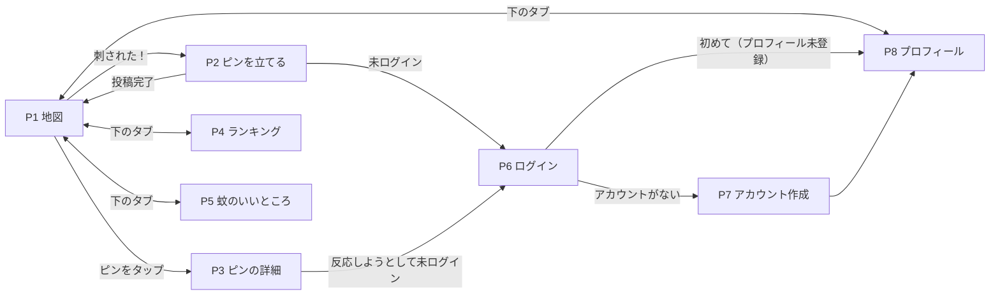

# mug 仕様書（蚊に刺された場所を共有するアプリ）

作成：Jiji824（叩き台）／ 作成日：2026-11-17 ／ 状態：**叩き台（チームで認識合わせ中）**

この文書は、**「mugは何のために、何を使って、何をするアプリで、どんなページがあるか」をチーム全員でそろえるため**のものです。
APIやDBの細かい形は、別の文書（「1-6 参考資料」）にあります。

### 印の意味

| 印 | 意味 |
|---|---|
| ✅ | 決定済み（Miroや会議で決まったこと、すでに作ったもの） |
| 🟡 | **要相談**。叩き台として書いた案。チームで決める |
| ⏸ | 保留。あとで決める |

### 目次
1. はじめに（背景と課題、目的、全体像・開発方針、使う技術、用語、参考資料）
2. システム開発の前提条件（制約条件、利用者）
3. システム要件（機能、機能外要求、性能目標、品質、セキュリティ、ライフサイクル、仮定と依存関係）
4. インターフェース（ページ一覧・ページの移り変わり・ページごとの要素と制限、ほかのソフトウェア、機器、通信）
5. 要相談のまとめ
6. 変更履歴

---

## 1. はじめに

### 1-1. 開発の背景と現状の課題

**背景** ✅
- ハッカソン（期間1週間）のテーマ「**痒い所に手が届くようなアプリ**」に合わせて、チームの投票で決めたアプリです。
- テーマの「痒い」を文字どおりに受け取り、「蚊に刺されてかゆい」という身近な困りごとを扱います。

**現状の課題** 🟡
| 課題 | 今はどうしているか |
|---|---|
| どこで蚊に刺されやすいか、事前に分からない | 刺されてから気づく。虫よけを使うかどうかも勘で決めている |
| 刺されやすい場所の情報が、個人の経験に閉じている | 家族や友人との会話で伝わる程度で、地図として共有されていない |
| 刺されてかゆいのに、気持ちを共有する場がない | 一人で我慢するか、SNSで愚痴をこぼす程度 |
| 蚊はただ嫌なものとして扱われている | 楽しく付き合うきっかけがない |

### 1-2. 開発の目的

**実現したいこと** ✅
「ここで蚊に刺された」を地図に投稿していく**位置情報のSNS**を作り、みんなの投稿から**蚊に刺されやすい場所**が分かるようにします。

**提供したい価値** 🟡
| 価値 | どうやって |
|---|---|
| 刺されやすい場所が分かる | 地図上のピンの集まり方で見せる |
| 刺されたつらさを共有できる | 「お大事に」「掻いてあげる」などのスタンプやコメント |
| 蚊と少し楽しく付き合える | ランキング（人・市町村・血液型）、「蚊のいいところ」のページ |
| 安心して投稿できる | 位置をぼかし、ピンを匿名にする |

**ハッカソンでのゴール** 🟡
- 水曜12:00の提出時点で、「ピンを立てる → 地図に出る → スタンプ・コメントで反応 → ランキングに反映」がデモできること

### 1-3. 全体像・開発方針

**全体像** ✅
```
[スマホ・PCのブラウザ]
      │  画面の表示、/api の呼び出し（HTTPS）
      ▼
[Cloudflare Worker「mug」]  画面のファイルを配信／/api だけAWSに中継（署名付き）
      │
      ▼
[AWS Lambda]  ログインの確認、位置のぼかし、入力チェック、DBの読み書き
      │
      ├─ [DynamoDB]  プロフィール、ピン、コメント、スタンプ、ランキングの件数
      ├─ [Cognito]  アカウント（メールアドレス・パスワード）
      └─ [国土地理院の逆ジオコーディングAPI]  位置から市町村を判定

地図の画像：ブラウザが OpenFreeMap から直接取得（MapLibre GL JS で表示）
```
詳しくは `docs/architecture.md`。

**開発方針** ✅
| 方針 | 内容 |
|---|---|
| 費用 | AWS・Cloudflareの無料枠の範囲で作る |
| 体制 | 4人。フロント担当、バックエンド・インフラ担当（Jiji824） |
| 進め方 | 先にAPIの形（`docs/api-spec.md`）を決め、フロントとバックエンドを並行で作る |
| 作る順番 | まず「画面 → Worker → Lambda」の道を通す（完了） → プロフィール → ピン → コメント・スタンプ・ランキング |
| ソースコード | GitHubのOrganizationの非公開リポジトリ `mug`。mainにマージすると自動でデプロイ |
| AIの利用 | Claude Codeなどを使う。ルールは `AGENTS.md` |

### 1-4. 使う技術 ✅

| 役割 | 使うもの |
|---|---|
| 画面 | React＋TypeScript＋Vite＋shadcn/ui |
| 地図 | OpenFreeMap（地図の画像）＋MapLibre GL JS（表示） |
| 画面の配信・入口 | Cloudflare Workers（`https://mug.st2026ne.workers.dev`） |
| API | AWS Lambda（Node.js・TypeScript） |
| データ | AWS DynamoDB |
| ログイン | AWS Cognito（メールアドレス＋パスワード） |
| 市町村の判定 | 国土地理院の逆ジオコーディングAPI |
| AWSの構築 | AWS CDK（TypeScript） |
| ソースコード・自動デプロイ | GitHub（mainにマージするとCloudflareが自動デプロイ） |

### 1-5. 用語の定義

| 用語 | 意味 |
|---|---|
| ピン | 「ここで刺された」という1件の投稿。地図上に表示される |
| ずらし（位置のぼかし） | ピンの位置を、元の位置から半径100mの円の中でランダムに動かして保存すること |
| メモ | ピンを立てるときに書ける短い文章。匿名 |
| スタンプ | ピンに付ける気持ちのマーク。「かゆい」「お大事に」など |
| リアクション | 他人のピンにスタンプを押すこと（Slackのリアクションのようなもの） |
| コメント | ピンに付けられる短い返信。スレッド形式で、ニックネームが表示される |
| プロフィール | ニックネームと血液型 |
| ランキング | 月ごとの「蚊に好かれてる人」「市町村」「血液型」のランキング |
| 市町村コード（muniCd） | 国土地理院のAPIが返す市区町村の番号。市町村ランキングの集計に使う |
| IDトークン | ログインすると受け取る証明書のようなもの。APIを呼ぶときに付ける |

### 1-6. 参考資料

| 資料 | 内容 |
|---|---|
| `docs/api-spec.md` | API仕様書（送るもの・返すもの、エラーの形） |
| `docs/db-schema.md` | DB設計（テーブルと保存する項目） |
| `docs/architecture.md` | 構成と各サービスの役割、リスクと対策 |
| `docs/decisions.md` | 決めたことと、その理由 |
| `docs/dev-rules.md` | 開発のルール（ブランチ、デプロイ、締切、片付け） |
| `AGENTS.md` | AIに守らせるルール |
| チームのMiroボード | アイデア出しと構成の検討 |

---

## 2. システム開発の前提条件

### 2-1. 制約条件

**法律・規約による制約** 🟡（内容は要確認）
| 対象 | 制約 | mugでの対応 |
|---|---|---|
| 位置情報 | 位置情報は、ほかの情報と組み合わせると個人を特定できることがある | 位置を100mずらして保存、元の位置は保存しない、ピンは匿名 |
| 地図のデータ（OpenFreeMap／OpenStreetMap） | 地図の画面に出典（© OpenStreetMap contributors など）の表示が必要 | MapLibre の出典表示を消さない |
| 国土地理院の逆ジオコーディングAPI | 地理院地図のための仕組みで、外部からの利用は保証されていない | 呼び出しに失敗しても投稿は止めない。少量の利用にとどめる |
| Google Maps のAPI | 結果を長期保存してはいけない規約がある | 使わない（ランキング集計に保存が必要なため） |

**チーム・ハッカソンの方針による制約** ✅
| 制約 | 内容 |
|---|---|
| 期間 | 水曜10:00で新しい機能は打ち止め、12:00に提出 |
| 費用 | 無料枠の範囲（DynamoDBは読み書き各25ユニット以内、Workersは1日10万リクエスト以内など） |
| 秘密情報 | 外に置く秘密はAWSのキー1本だけ（CloudflareのSecretsに保存）。コードやログに書かない |
| 構成 | Workerは中継だけにする（いつでもAWSだけの構成に切り替えられるようにするため） |

### 2-2. システムの利用者

| 利用者 | 説明 | 状態 |
|---|---|---|
| 一般の利用者 | 屋外で過ごすことが多い人（公園、キャンプ、通勤・通学、子どもと外遊びをする人など） | 🟡 |
| ハッカソンの審査員・参加者 | デモで触る人。メンバーとダミーのデータで見せる | ✅ |
| 管理者 | 置かない（管理画面は作らない） | 🟡 |

**利用者の種類とできること**

| できること | ログインしていない人 | ログインしたが、プロフィール未登録の人 | プロフィール登録済みの人 |
|---|---|---|---|
| 地図でピンを見る | ✅ できる | ✅ できる | ✅ できる |
| ピンの詳細・コメントを見る | ✅ できる | ✅ できる | ✅ できる |
| ランキングを見る | ✅ できる | ✅ できる | ✅ できる |
| 蚊のいいところを見る | ✅ できる | ✅ できる | ✅ できる |
| ピンを立てる | ✗（ログインへ案内） | ✗（プロフィール登録へ案内） | ✅ できる |
| コメントする | ✗（ログインへ案内） | ✗（プロフィール登録へ案内） | ✅ できる |
| スタンプを押す | ✗（ログインへ案内） | ✗（プロフィール登録へ案内） | ✅ できる |

見るだけならログイン不要、投稿・反応にはログインとプロフィール登録が必要（API仕様の🌐／🔒のとおり）。最終的には画面の案と合わせて確認 🟡

---

## 3. システム要件

### 3-1. 機能

#### 機能一覧

| ID | 機能 | 状態 | 使うAPI | 主なページ |
|---|---|---|---|---|
| F-01 | アカウント作成・ログイン・ログアウト | ✅ Cognitoに決定 | （Cognito） | P6、P7、P8 |
| F-02 | プロフィールの登録・変更 | ✅ | `GET/PUT /api/me` | P8 |
| F-03 | 地図でピンを見る | ✅ | `GET /api/pins` | P1 |
| F-04 | ピンを立てる（刺された場所を投稿） | ✅ | `POST /api/pins` | P2 |
| F-05 | ピンの詳細を見る | ✅ | `GET /api/pins`、`GET .../comments` | P3 |
| F-06 | コメントする・見る | ✅ | `GET/POST /api/pins/{pinId}/comments` | P3 |
| F-07 | スタンプを押す・取り消す（リアクション） | ✅ | `PUT/DELETE /api/pins/{pinId}/reactions/{type}` | P3 |
| F-08 | ランキングを見る | ✅ | `GET /api/rankings` | P4 |
| F-09 | 蚊のいいところを見る | ✅ 別ページ・固定の文章 | なし | P5 |
| F-10 | 自分のピンを消す | 🟡 作るか未定 | （作るなら `DELETE /api/pins/{pinId}` を追加） | P3 |

ページ（P1〜P8）は「4-1 ユーザーインターフェース」を参照。

#### F-01 アカウント作成・ログイン・ログアウト

| 項目 | 仕様 | 状態 |
|---|---|---|
| 仕組み | AWS Cognito（ユーザープール） | ✅ |
| ログインに使うもの | メールアドレス＋パスワード | ✅ |
| アカウント作成 | 自分で登録できる。登録後、メールに届く確認コードを入力して有効にする | ✅ |
| パスワードの条件 | Cognitoの初期設定に従う（8文字以上、大文字・小文字・数字・記号を含む） | 🟡 ゆるめるか相談 |
| ログインの持続 | IDトークンの期限は1時間。切れたらライブラリが自動で取り直すので、利用者は意識しない | ✅ |
| ログアウト | できる。ログアウト後は「ログインしていない人」になる | ✅ |
| パスワードを忘れたとき | Cognitoの「パスワードを忘れた」機能を使う | 🟡 デモに必要か |
| 外部のアカウント（Google等）でのログイン | 作らない | 🟡 |

#### F-02 プロフィールの登録・変更

| 項目 | 仕様 | 状態 |
|---|---|---|
| 登録するもの | ニックネーム、血液型 | ✅ |
| ニックネーム | 1〜20文字。ほかの人と同じでもよい | ✅（重複可かは 🟡） |
| 血液型 | A／B／O／AB／答えない | ✅ |
| いつ登録するか | ログイン後、初めて使うとき。未登録ならプロフィール登録へ案内する | ✅ |
| 変更 | いつでもできる | ✅ |
| 変更したときの過去のコメント | 過去のコメントのニックネームは**変わらない**（投稿したときの名前のまま） | ✅ |
| 変更したときのランキングの表示名 | 新しいニックネームに変わるか | 🟡 |

#### F-03 地図でピンを見る

| 項目 | 仕様 | 状態 |
|---|---|---|
| 地図 | OpenFreeMap＋MapLibre GL JS。スタイルは Positron か Liberty（フロント担当が見比べて決める） | ✅（スタイルは 🟡） |
| 最初に表示する場所 | 現在地。位置情報の許可がない・取れないときは代々木公園あたり（ダミーデータが見えるように。docs/adr/feature-front-viewer.md） | 🟡 |
| 表示するピン | 地図に今見えている範囲のピン。新しい順に最大200件 | ✅（件数は 🟡） |
| 200件を超えるとき | 「拡大してください」と表示する | ✅ |
| 広すぎる範囲 | 縦横それぞれ0.5度（約50km）より広い範囲は取得しない。「拡大してください」と表示する | ✅ |
| ピンの見た目 | スタンプ（かゆい・いたい）で見た目を変えるか | 🟡 |
| ピンが多い場所の見せ方 | 重なったピンをまとめる（クラスター表示）か、ヒートマップにするか | 🟡 |
| 期間の絞り込み | 「今月だけ」などの絞り込み | ⏸ |
| 地図の地名と市町村の判定のずれ | 地図はOpenFreeMap、市町村の判定は国土地理院なので、境界付近でずれることがある。ランキングは国土地理院の判定に従う | ✅ |

#### F-04 ピンを立てる（刺された場所を投稿）

| 項目 | 仕様 | 状態 |
|---|---|---|
| 位置 | 基本は現在地。利用者が地図上でピンを動かすこともできる | ✅ |
| 位置の範囲 | 日本の範囲（緯度20〜46、経度122〜154）だけ | ✅ |
| 位置のぼかし | 保存するとき、サーバーが**半径100mの円の中でランダムにずらす**。元の位置は保存もログ出力もしない | ✅ |
| 位置情報の許可がないとき | 地図上で場所を選んでもらう | 🟡 |
| スタンプ | 「かゆい」「いたい」から選ぶ | ✅（必須か任意かは 🟡） |
| メモ | 0〜100文字。**匿名で表示**（誰が書いたか分からない） | ✅ |
| 市町村 | ずらした後の位置から国土地理院のAPIで判定。海上や判定できないときは「不明」で、投稿は成功させる。「不明」は市町村ランキングに数えない | ✅ |
| 投稿のあと | 地図に自分のピンが表示される（ずらした後の位置） | ✅ |
| ランキングへの反映 | 投稿するたびに、その月の「人」「市町村」「血液型」の件数が1つ増える | ✅ |
| 投稿の回数制限 | いたずら防止に、短時間の連続投稿を制限するか（例：1分に1回） | 🟡 |
| 投稿の時刻 | サーバーが決める（日本時間）。「刺された時刻」は別に持たない | ✅（区別するかは 🟡） |

#### F-05 ピンの詳細を見る

| 項目 | 仕様 | 状態 |
|---|---|---|
| 開き方 | 地図上のピンをタップする | ✅ |
| 表示するもの | スタンプ、メモ、市町村、投稿日時、リアクションの数、コメント | ✅ |
| 表示しないもの | **誰が立てたピンか**（ニックネームやユーザーID） | ✅ |
| 「自分のピン」の印 | 付けるか（付けるならAPIの追加が必要） | 🟡 |

#### F-06 コメントする・見る

| 項目 | 仕様 | 状態 |
|---|---|---|
| 形式 | ピンごとのスレッド。古い順に表示 | ✅ |
| 表示するもの | ニックネーム、コメント、日時 | ✅ |
| 文字数 | 1〜100文字 | ✅ |
| 表示件数 | 1つのピンにつき最大100件 | ✅ |
| 匿名かどうか | コメントは**ニックネームを表示**（ピンとメモは匿名、コメントは記名） | ✅ |
| 削除・編集 | 作らない | 🟡 |

#### F-07 スタンプを押す・取り消す（リアクション）

| 項目 | 仕様 | 状態 |
|---|---|---|
| 押せるスタンプ | 「お大事に」「掻いてあげる」「わかる」 | ✅（種類は 🟡） |
| 回数 | 1人が同じスタンプを押せるのは、1つのピンにつき1回。押したスタンプをもう一度押すと取り消し | ✅ |
| 表示 | スタンプごとの数と、自分が押したかどうか | ✅ |
| 自分のピンに押せるか | 押せる | 🟡 |
| 誰が押したかの表示 | 表示しない（数だけ） | 🟡 |

**スタンプの一覧**

| 値 | 表示 | 使う場所 | 状態 |
|---|---|---|---|
| `kayui` | かゆい | ピンを立てるとき | ✅ |
| `itai` | いたい | ピンを立てるとき | ✅ |
| `odaiji` | お大事に | 他人のピンへのリアクション | ✅ |
| `kaite` | 掻いてあげる | 他人のピンへのリアクション | ✅ |
| `wakaru` | わかる | 他人のピンへのリアクション | ✅ |

絵文字やイラストを付けるかは、画面の案で決める 🟡

#### F-08 ランキングを見る

| 項目 | 仕様 | 状態 |
|---|---|---|
| 種類 | ①蚊に好かれてる人（ピンを立てた回数） ②市町村 ③血液型 | ✅ |
| 期間 | 月単位（その月の1日〜月末、日本時間） | ✅ |
| 表示する月 | 初めは今月。過去の月も選べる | ✅（選び方は 🟡） |
| 表示件数 | 上位20件。同じ件数なら同じ順位 | ✅ |
| 表示名 | 人：ニックネーム／市町村：「都道府県＋市区町村」／血液型：「A型」など | ✅ |
| 血液型「答えない」 | **出さない**。ランキングは「どの血液型が刺されやすいか」を見るものなので、「答えない」の人は順位に入れない（件数は数えているので、あとで出すようにも戻せる） | ✅ |
| 自分の順位 | 20位より下でも表示するか | 🟡 |

#### F-09 蚊のいいところを見る

| 項目 | 仕様 | 状態 |
|---|---|---|
| 形式 | 別ページ。固定の文章（APIは使わない） | ✅ |
| 内容 | 蚊についての豆知識や、意外なよいところ | 🟡 内容と担当 |
| 出典 | 事実を書く場合は、出典をページに載せる | 🟡 |

#### F-10 自分のピンを消す 🟡
作るかどうか未定。作る場合の案：自分のピンだけ消せる／消したピンのコメントとリアクションも消える／ランキングの件数を減らすかは要相談。

#### 使われ方の例

**例1：初めて使って、刺された場所を投稿する**
1. アプリを開くと、現在地の周りの地図とピンが表示される（P1）
2. 「刺された！」ボタンを押す → ログインしていないので、ログインへ案内される（P6）
3. メールアドレスとパスワードでアカウントを作り、確認コードを入力する（P7）
4. プロフィール登録で、ニックネームと血液型を入力する（P8）
5. 地図に戻り、現在地にピンを置く（必要なら少し動かす）（P2）
6. スタンプ「かゆい」を選び、メモ「公園のベンチの近く」を書いて投稿する
7. 地図に自分のピンが表示される（100mずらした位置）

**例2：見るだけで使う**
1. ログインせずにアプリを開き、近所のどこにピンが多いかを見る（P1）
2. ピンをタップして、メモやコメントを読む（P3）
3. ランキングで、今月刺されている市町村を見る（P4）

**例3：他人のピンに反応する**
1. ログインした状態で、地図のピンをタップする（P3）
2. 「お大事に」のスタンプを押し、コメント「この辺り多いですよね」を書く（ニックネーム付きで表示される）

### 3-2. 機能外要求（拡張性・保守性・移植性）

| 項目 | 要求 | 状態 |
|---|---|---|
| 拡張性 | 機能を足すときは、APIを1本ずつ追加できる作り（Lambdaの中でパスごとに振り分け） | ✅ |
| 保守性 | 設計の文書（`docs/`）とコードを同じリポジトリに置き、設定を変えたら文書も直す | ✅ |
| 保守性 | AWSのリソースはコード（CDK）で作る。手で作らない | ✅ |
| 移植性 | Workerは中継だけにして、Cloudflareだけの機能（KV、D1など）は使わない。いつでもAWSだけの構成（CloudFront＋S3）に切り替えられるようにする | ✅ |
| 移植性 | 画面からAPIは相対パス（`/api/...`）で呼ぶ | ✅ |

### 3-3. 性能目標

| 項目 | 目標 | 状態 |
|---|---|---|
| 同時に使う人数 | デモで数人〜数十人 | ✅ |
| ピンの投稿 | 平常時1秒に1件程度まで（DynamoDBの無料枠の設定による） | ✅ |
| 地図の表示 | 範囲内のピン（最大200件）を、体感で待たされない速さ（目安1秒以内）で表示 | 🟡 |
| APIの応答 | 目安1秒以内（初回の呼び出しは、Lambdaの起動で少し遅くなることがある） | 🟡 |
| 無料枠を超えたとき | DynamoDBは上限で止まる（料金は増えない）。AWSの予算アラート（$1）で気づく | ✅ |

### 3-4. 品質属性

| 項目 | 要求 | 状態 |
|---|---|---|
| 使いやすさ | 刺されてすぐ、片手で投稿できる（投稿までの操作を少なくする） | 🟡 |
| 正しさ | 入力は必ずサーバーでチェックする（文字数、緯度経度の範囲、スタンプの種類）。画面でも同じ制限でチェックする | ✅ |
| エラーの伝え方 | エラーは決まった形（`{"error": "...", "message": "..."}`）で返し、画面は `message` を表示できる | ✅ |
| 対応する端末 | スマホのブラウザを主にする | 🟡 |
| 対応するブラウザ | 最新のChrome・Safari | 🟡 |
| 言語 | 日本語のみ | 🟡 |

### 3-5. セキュリティ目標

**プライバシー** ✅
| ルール | 理由 |
|---|---|
| ピンの位置は、保存するときに**半径100mの円の中でランダムにずらす** | 自宅や職場などの正確な場所が分からないようにする |
| 元の位置は**保存もログ出力もしない** | 万一データが漏れても、正確な場所が出ないようにする |
| ピンとメモは**匿名**（誰が立てたか表示しない） | 「この人はここによくいる」が分からないようにする |
| コメントとランキングはニックネームを表示 | 交流のため。どのピンを立てた人かは分からない |
| 地図に一度に表示するのは最大200件、広すぎる範囲は取得しない | データの丸ごとの取得を防ぐ |

**不正な利用を防ぐ** ✅
| ルール | 理由 |
|---|---|
| 利用者の特定は、ログインのトークン（IDトークン）だけで行う。画面からユーザーIDを送らない | なりすましを防ぐ |
| AWSの関数は、Workerの署名付きのリクエストだけを受け付ける（直接は呼べない） | 入口を1つにし、勝手な呼び出しを防ぐ |
| Workerが使うAWSのキーは、「この関数を関数URL経由で呼ぶ」権限だけ | キーが漏れたときの被害を小さくする |
| ログに、トークン・キー・位置・リクエストの本文を出さない | ログからの漏れを防ぐ |
| 全員GitHubの2段階認証をオン | リポジトリの乗っ取りを防ぐ |

**残っている心配** 🟡
- **同じ人が同じ場所に何度もピンを立てると、ずらした位置の平均から元の位置が推測できる**（平均化攻撃）。投稿の回数制限などの対策を相談する
- 不適切なメモやコメントへの対応（通報・削除）は作らない予定。デモの範囲では、メンバーとダミーのデータだけで運用する

### 3-6. システムのライフサイクルと維持管理

| 項目 | 方針 | 状態 |
|---|---|---|
| 開発 | ブランチで作業し、区切りごとにpush。動作を確認できたらmainにマージ | ✅ |
| リリース | mainにマージすると、Cloudflareが自動で画面とWorkerをデプロイ。AWS側はJiji824が `cdk deploy` | ✅ |
| 監視 | AWSの予算アラート（$1）、Lambdaのログ（1週間で自動削除）、Workerのログ（メソッド・パス・結果だけ） | ✅ |
| 保存するデータ | プロフィール、ずらした後のピンの位置、メモ、コメント、スタンプ、ランキングの件数。メールアドレスとパスワードはCognitoが保存（アプリのDBには入れない） | ✅ |
| ハッカソン後 | 残すか消すかを決める。消す場合は、`docs/dev-rules.md` の片付けの手順（`cdk destroy`、Workerの削除、キーの削除など） | ⏸ |

### 3-7. 仮定と依存関係

**仮定（こうであることを前提にしている）** 🟡
- 利用者のブラウザで位置情報が使える（許可してもらえる）
- 利用者はメールアドレスを持っていて、確認コードを受け取れる
- デモの時間帯に、外部のサービス（下表）が止まっていない

**依存している外部のサービス** ✅
| サービス | 何に使うか | 止まったとき |
|---|---|---|
| Cloudflare Workers | 画面の配信、AWSへの中継 | アプリ全体が使えない |
| AWS（Lambda、DynamoDB、Cognito） | API、データ、ログイン | 画面は出るが、ログイン・投稿・表示ができない |
| OpenFreeMap | 地図の画像 | 地図が出ない（ピンのデータは取れる） |
| 国土地理院の逆ジオコーディングAPI | 市町村の判定 | 投稿はできる。市町村が「不明」になる |
| GitHub | ソースコード、自動デプロイのきっかけ | 開発・デプロイが止まる（動いているアプリは止まらない） |

---

## 4. インターフェース

### 4-1. ユーザーインターフェース（ページ）🟡

画面の案はまだないので、機能から考えた叩き台です。フロント担当と決めてください。文字数や件数などの制限は、ほとんどが `docs/api-spec.md` で決まっている値（✅）なので、画面の入力チェックにもそのまま使えます。

#### ページ一覧

| # | ページ | 何をするページか | ログイン |
|---|---|---|---|
| P1 | 地図（トップ） | ピンを見る。ここから投稿・詳細へ | 不要 |
| P2 | ピンを立てる | 刺された場所を投稿する | **必要** |
| P3 | ピンの詳細 | メモ・コメント・スタンプを見る、反応する | 見るのは不要、反応は**必要** |
| P4 | ランキング | 月ごとのランキングを見る | 不要 |
| P5 | 蚊のいいところ | 蚊の豆知識を読む | 不要 |
| P6 | ログイン | ログインする | ― |
| P7 | アカウント作成 | アカウントを作り、確認コードで有効にする | ― |
| P8 | プロフィール | ニックネーム・血液型の登録と変更、ログアウト | **必要** |

**ページの移り変わり（案）**



- 画面の下にタブ（地図／ランキング／蚊のいいところ／プロフィール）を置く案 🟡
- P2・P3は、別のページではなく、地図の上に重ねて出すシート（ボトムシート）にする案 🟡


#### ページごとの要素と制限

##### 共通

| 要素 | 内容 | 制限・幅 |
|---|---|---|
| 下のタブ | 地図／ランキング／蚊のいいところ／プロフィール | 🟡 |
| エラーの表示 | APIが返す `message` をそのまま表示 | ― ✅ |
| 読み込み中の表示 | APIを呼んでいる間に表示 | ― 🟡 |
| 対応する端末 | スマホのブラウザを主にする | 🟡 |
| 言語 | 日本語のみ | 🟡 |

##### P1 地図（トップ）

| 要素 | 内容 | 制限・幅 |
|---|---|---|
| 地図 | OpenFreeMap。スタイルは Positron か Liberty | 🟡 スタイル |
| 最初の表示位置 | 現在地。位置情報の許可がない・取れないときは代々木公園あたり（取得を待つ間も先に表示し、取れたら移動） | 🟡 |
| ピン | 今見えている範囲のピン | 新しい順に**最大200件** ✅／表示範囲が縦横**0.5度（約50km）**を超えたら取得しない ✅ |
| ピンの見た目 | スタンプ（かゆい・いたい）で色やアイコンを変える | 🟡 |
| 「拡大してください」 | 200件を超えたとき、範囲が広すぎるとき | ✅ |
| 現在地ボタン | 地図を現在地に戻す | ✅ |
| 「刺された！」ボタン | P2を開く | ✅ |
| 地図の出典表示 | © OpenStreetMap contributors など | **消さない** ✅ |

##### P2 ピンを立てる

| 要素 | 内容 | 制限・幅 |
|---|---|---|
| 位置 | 現在地にピンを置く。地図上で動かせる | 日本の範囲（**緯度20〜46、経度122〜154**）✅ |
| スタンプ | 「かゆい」「いたい」から1つ | 2種類 ✅／必須か任意か 🟡 |
| メモ | 自由に書ける短い文章（匿名） | **0〜100文字** ✅ |
| 注意書き | 「位置は100mほどずらして保存されます」「メモは匿名で表示されます」 | ✅ |
| 投稿ボタン | 投稿してP1に戻る。自分のピンが地図に出る | 連続投稿の制限（例：1分に1回）🟡 |
| 位置情報の許可がないとき | 地図で場所を選んでもらう | 🟡 |

##### P3 ピンの詳細

| 要素 | 内容 | 制限・幅 |
|---|---|---|
| スタンプ | 立てた人が選んだもの（かゆい・いたい） | ✅ |
| メモ | 匿名で表示（誰が書いたか出さない） | 最大100文字 ✅ |
| 市町村 | 「東京都千代田区」など。判定できなければ「不明」 | ✅ |
| 投稿日時 | 例：11/17 10:30 | ✅ |
| リアクション | 「お大事に」「掻いてあげる」「わかる」と、それぞれの数。自分が押したものは色を変える | 3種類 ✅／1人1種類1回、もう一度押すと取り消し ✅ |
| コメント一覧 | ニックネーム、コメント、日時。古い順 | **最大100件** ✅ |
| コメント入力 | 書いて送信。ニックネーム付きで表示される | **1〜100文字** ✅ |
| 表示しないもの | 誰が立てたピンか（ニックネーム・ID） | ✅ |

##### P4 ランキング

| 要素 | 内容 | 制限・幅 |
|---|---|---|
| 種類の切り替え | 蚊に好かれてる人／市町村／血液型 | 3種類 ✅ |
| 月の切り替え | 今月と過去の月 | 月単位（1日〜月末、日本時間）✅ |
| ランキング | 順位、名前（ニックネーム・市町村名・血液型）、件数 | **上位20件**、同じ件数は同じ順位 ✅ |
| 血液型「答えない」 | **出さない**。ランキングは「どの血液型が刺されやすいか」を見るものなので、「答えない」の人は順位に入れない（件数は数えているので、あとで出すようにも戻せる） | ✅ |
| 自分の順位 | 20位より下でも表示するか | 🟡 |

##### P5 蚊のいいところ

| 要素 | 内容 | 制限・幅 |
|---|---|---|
| 本文 | 蚊の豆知識や意外なよいところ（固定の文章） | 🟡 内容と担当 |
| 出典 | 事実を書く場合は出典を載せる | 🟡 |

##### P6 ログイン

| 要素 | 内容 | 制限・幅 |
|---|---|---|
| メールアドレス | 入力欄 | メールアドレスの形式 ✅ |
| パスワード | 入力欄 | ✅ |
| ログインボタン | ログイン後、プロフィール未登録ならP8へ、登録済みなら元のページへ | ✅ |
| 「アカウントを作る」 | P7へ | ✅ |
| 「パスワードを忘れた」 | デモに必要か | 🟡 |

##### P7 アカウント作成

| 要素 | 内容 | 制限・幅 |
|---|---|---|
| メールアドレス | 入力欄 | メールアドレスの形式 ✅ |
| パスワード | 入力欄 | **8文字以上**、大文字・小文字・数字・記号を含む（Cognitoの初期設定）🟡 ゆるめるか |
| 確認コード | メールに届いたコードを入力 | **6桁の数字** ✅ |
| 作成ボタン | 有効になったらP8へ | ✅ |

##### P8 プロフィール

| 要素 | 内容 | 制限・幅 |
|---|---|---|
| ニックネーム | 入力欄。コメントとランキングに表示される | **1〜20文字** ✅／ほかの人と同じでもよい 🟡 |
| 血液型 | 選択 | **A／B／O／AB／答えない** の5つ ✅ |
| 保存ボタン | 登録・変更 | いつでも変更できる ✅（過去のコメントの名前は変わらない） |
| ログアウト | ログアウトしてP1へ | ✅ |

### 4-2. ソフトウェアインターフェース（ほかのソフトウェアとの連携）

| 相手 | やり取り | 状態 |
|---|---|---|
| Cognito | 画面からサインアップ・ログインし、IDトークンを受け取る。Lambdaはトークンを検証する（aws-jwt-verify） | ✅ |
| 国土地理院の逆ジオコーディングAPI | Lambdaが、ずらした後の緯度経度を送り、市町村コード（muniCd）を受け取る。名前はLambda内の変換表で付ける | ✅ |
| OpenFreeMap | ブラウザが地図の画像（タイル）を直接受け取る | ✅ |
| 自分たちのAPI | `docs/api-spec.md` のとおり（9本） | ✅ |

### 4-3. ハードウェアインターフェース（機器との接続）

| 機器 | 使い方 | 状態 |
|---|---|---|
| スマホ・PCの位置情報（GPSなど） | ブラウザの位置情報の機能で現在地を取得する。許可がなければ地図で場所を選んでもらう | ✅（許可がないときの動きは 🟡） |
| そのほかの機器（カメラなど） | 使わない | ✅ |

### 4-4. 通信インターフェース

| 項目 | 仕様 | 状態 |
|---|---|---|
| 通信方式 | HTTPSのみ（本番URL：`https://mug.st2026ne.workers.dev`） | ✅ |
| APIの呼び方 | 相対パス（`/api/...`）。送るのも返すのもJSON | ✅ |
| ログインの証明 | `X-Id-Token` ヘッダーにIDトークンを入れる（`Authorization` は使わない。WorkerがAWSの署名で上書きするため） | ✅ |
| POST・PUT | `x-amz-content-sha256` ヘッダー（送る本文のSHA-256）を付ける | ✅ |
| WorkerからAWSへ | AWSの署名（SigV4）を付けて、Lambdaの関数URLに中継する | ✅ |
| エラーの形 | `{"error": "VALIDATION_ERROR", "message": "..."}`（種類は `docs/api-spec.md`） | ✅ |

---

## 5. 要相談のまとめ

チームで決めることを集めました。決まったら、各章の印を ✅ に変えてください。

| # | 内容 | 関係する章 |
|---|---|---|
| 1 | 現状の課題と提供したい価値の書き方、ハッカソンでのゴール | 1-1、1-2 |
| 2 | 法律・規約の制約の確認（位置情報、地図の出典表示、国土地理院API） | 2-1 |
| 3 | 主な利用者、管理者を置くか | 2-2 |
| 4 | 見るだけの機能はログインなしで使えるようにするか | 2-2 |
| 5 | **ページの分け方、下のタブ、P2・P3をシートにするか** | 4-1 |
| 6 | 地図のスタイル、最初の表示位置、ピンの見た目、ピンが多い場所の見せ方、最大件数 | F-03、P1 |
| 7 | ピンを立てるときのスタンプは必須か任意か、連続投稿の制限（いたずら・平均化攻撃の対策） | F-04、P2、3-5 |
| 8 | 位置情報の許可がないときの投稿方法 | F-04、P2、4-3 |
| 9 | 「自分のピン」の印、コメントの削除・編集 | F-05、F-06、P3 |
| 10 | スタンプの種類と見た目、自分のピンに押せるか | F-07、P3 |
| 11 | ランキングの自分の順位の表示（「答えない」血液型は出さないと決定 ✅） | F-08、P4 |
| 12 | 蚊のいいところの内容と担当 | F-09、P5 |
| 13 | パスワードの条件、「パスワードを忘れた」はデモに必要か | F-01、P6、P7 |
| 14 | ニックネームの重複を許すか、変更したときのランキングの表示名 | F-02、P8 |
| 15 | 自分のピンを消す機能を作るか（作るならP3に削除ボタン） | F-10、P3 |
| 16 | 性能の目安、対応する端末・ブラウザ・言語、使いやすさの目標 | 3-3、3-4 |
| 17 | ハッカソン後にデータを残すか消すか | 3-6 |
| 18 | 画面のイメージ（ラフやスクリーンショット）を4-1に追加 | 4-1 |

---

## 6. 変更履歴

| 日付 | 内容 | 担当 |
|---|---|---|
| 2026-11-17 | 叩き台を作成（要求仕様書の一般的な章立てに、使う技術・ページ一覧・ページごとの要素と制限を加えた） | Jiji824 |
| 2026-11-17 | F-08・P4：血液型「答えない」はランキングに出さないと決定（要相談のまとめ 11 も更新） | Jiji824 |
