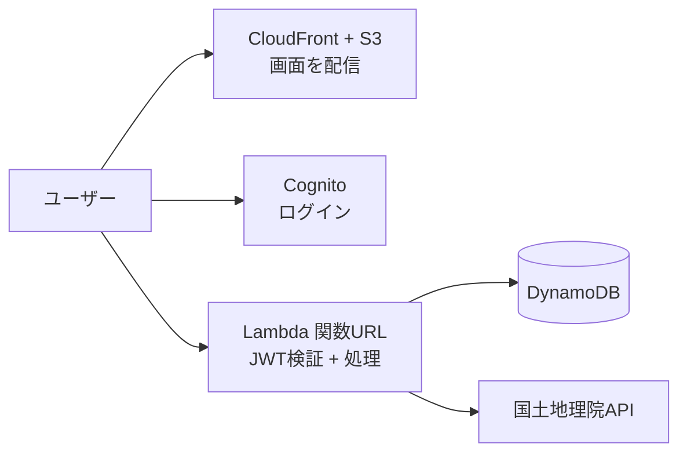
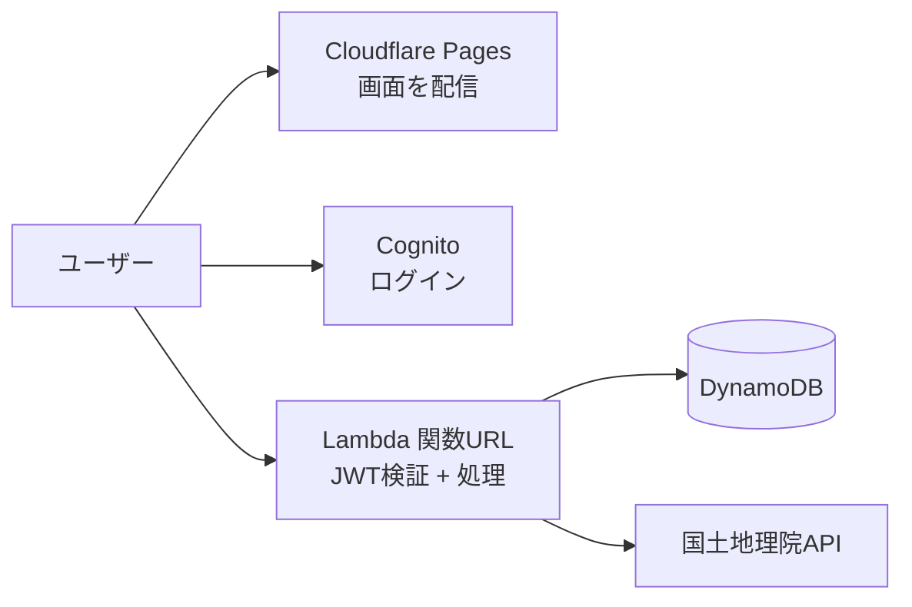
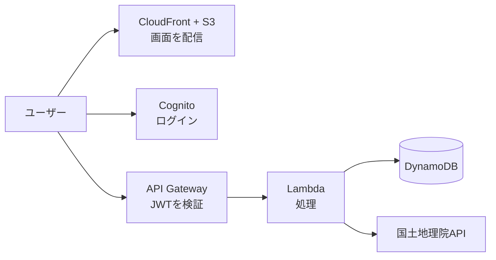
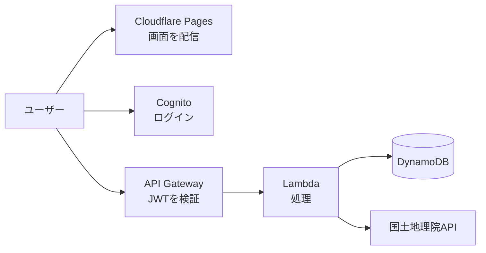

# 構成案の比較（mug：蚊に刺された場所を共有するアプリ）

作成：小松（バックエンド担当）／ 作成日：2026-11-16 ／ 関連：[api-spec.md](./api-spec.md)・[db-schema.md](./db-schema.md)・[decisions.md](./decisions.md)

## 構成図

- draw.ioファイル：[hackathon-architecture.drawio](./hackathon-architecture.drawio)（docs/フォルダ）
  - ページの並び：案D → 案C → 案A → 案B（案E・案F の構成図は未作成。Miro の各フレームを参照）
- ブラウザで見る場合：[構成図をdraw.ioビューアーで開く](https://viewer.diagrams.net/?lightbox=1&nav=1#R7V1Zd9pIt%2F01fuxeGkE8liRwlA%2BJYETc5CWLKTIyGF8DAenX33NOaQIEhhgbiJWsbjSUajhn17SraudGNiarX6Px8EYSHqaz%2BY1s3khS9%2Fn538Go6710J7N%2Fn4ZzeHQjV29kI3oIgUcDHvQZ%2Fwf3T93JkD%2B5qZZumHijaebPb11vOLup1m5040bT2TcLAt5258NlN4ifahhcq94wuFBvmEoX%2FFUlSXayun3pPj%2FY08FwDFEMVjwlUREEnvogiJ4I8RPvJc6hmD5ojcJhHDB6uhgNIIvZgPPpdDwfPa8%2F7E%2Bfnob9%2Bdqz7svLdLke7Nd0vJ7qM1hg60Gr3x1vP70fDeYP0VO5JKQvvgxH3kOctBQXcNKNQ0cPZg%2FdwXSZeUSme5lO57ERjeF4vOY6%2FmVt5%2Fskdy%2FDp%2FmhH%2F0zH80RT%2Fjl7%2B54EcNCKo0hDr0HFx5epDiJHF5hxni6GPwaQ3LwLQcPFCXGD1z%2FAYR4qpDhNGFurnkQO2E%2BXOHzh%2FlkDA9EuPw1fZpHYJEUuO%2BOR94T3IyHvzDk7%2BHLfAROZNHjyWgwwMjoO2M6nr5QxLLYxb9JkvjZcLXh%2BKxpxSzih9PJcP4SQKDoEyVydIT1fyrR%2FTIDnAT%2FDxnQyEoE2AisXhJ16ki4iHy506%2BzRW%2Fbq7ETjZuqfKOJN6xKF8KNZpA3ay9gksSFLTl%2Ba9KFdFORcpweRQUQKd%2FoZhynSF%2BBq2s3FT1%2BokUXlRplpYw4wTDaDZgnSktCXEAAnWGE8C1T4iTUOJ5alB%2BNZQpSQgRhhJWbSummIseB48JqSTxidKELcblkTBRuK%2FErxtKvjkKgqP45AtUK%2Fn0vBKqlbQRKeQiUSidBYP%2BXl9OubNjyZbp4GgwHkR2XD6P5sPXc7ePbJfQiG2YejccZc9VqNbVqwvPZ%2FGX6OMy%2BkTUB2iJZH3RnD0ns3Zd%2B5CTlVDbeNHJpu5Ynz7ImFjXhRDYeT73p62aG7uYZL0cT6uKyRt0E53z6nHla7%2FaG42%2FT2Wg%2BmuLb3nQ%2Bn04gAMXEZs%2B8nyXzxje%2FRiu0uR4lZg66c2hWGb%2BVarPfgAt9BRmQjG9fHOlHoE%2B696vZt5bl3%2Fm2YpvW0hrpQU9ajb%2B1vj737vsj68uP5x%2F%2FDYye7FUsn3m2wQKH%2FrO84a046z3ZFWvyIAy%2BsFI9qMgDub8YhPaiJ399qofW0jbZ777848nyFW1wOxZ6t23IQ1Na%2FR7c3016t7Xgh7v8nb759kV%2FGNx63g9TGLluVar77WXD9Dzb7SwaZlNwJHthu03ZaQkLx2VSw1CWDZcp9ZaiOiGT4XfluO2w7lYXdlgVHUNY2L4lOCMB7yW8d3wm0Pfmo0rhzM6Kx2ctnfvlHOKUHPcxwLhs1wo7PE617kN87iPaYGmZ1Tnch3Zowy%2BTbdfxIfzS9r0Qfx3Twueh42I4pjbMDv4GNqRju23RDjBsH%2FMN5WvCs2pgB%2FiuqTiGEtimLfGydIKe6S2c0BYb9C2Ek%2BxVJm6hYUKeRhDWZyv4RoG0FMu0FmgHJxAg7OPKDn%2FM6n5ThTjg3l5SfjE%2FbhvjEB0f7WCpPA%2FVAO2KdqY8%2BB6EaUu2355DOqJjdsC%2BFvjDFutuE%2BzYhPIIIoQRGu7jHPIvOGabwoCPwkaLLSmcb0HZII8%2B2Dvsz52WEjbMvmSZNsQFzwzySeBgHsKO2DAwr9UVhEnTbylyw23O07IAxvwO5lnF9AAnktPCNJgCeQrqmKZfRfsEDbMtJT7y7RVdmx0V8wPPEAehg%2FZz70xIB2ziheBnCFuV7Rb5XKj7fdlxm4iBlTNS4PqrD9eQbl%2BIbAZp2iLYFeKDX7AX%2BBnigPAm2hjTZopDPkcck30RW4ITfp%2Fidw3XWzm3gHPzcYm2swwIE7YJK47fFKnMIeIL8eiAX6uIVQHsoAwnWOY%2B5h3tC7%2B20EF7mn0qA%2FdndWWZDL63wP6YTnVlY%2F0A%2BzgjHgauBcQWx0cVfIL1rC%2F1sD6FttwgP1Zlx7zzKU6zj%2F5fcqww1XY9KEd%2FCd8Bhptox6j%2BAbbBl2h%2FKAvWRRHyCbiBOk7lszCeVcP9PoN7sJMtIwbskPAK5e173N70Hfo%2BpHroP2IZl7xekY0Fug7bmM%2BlEzYR34AxXqdSHIAvDMJ8SHXI9ER4B%2FWvyeuptETMqTbWD1735pRP8mVTAYwG6IeGifXBkxzCXBt97tF37t2M24dhmSHcdz%2BTNrQbNs8XhcH2jtoKxMbKmXjY%2FkG7NsCyy05YjcoOuME8Y%2Frkz0fuoxG1VxwLpheQf1ysO15IfgjbMrV3vgd2wjppof0DaPsC%2Br4lIL6x%2FuFvCBjFuixDWUb1UNHqMvQZoYId26l6cVVa78W1nF78HcdJNB1%2FdQqWHXq%2FdZ4kvmGeVNEVJmgns308wN5te1F6x0EqGnXL9uy%2BBQ%2BM9F3Grs%2FT0dOcElX1GxUxOF3Mx6MnGH%2FGrAOOPIF5GYyGqeGepk8bA6%2B8we6mi%2Bg%2BShu%2FAWZj3oW0XqJUKDPDl%2BrvIc%2BTQGHG4%2B7zbNSjr%2FDJy7C%2FeJmNfg%2FvhjMeOT6Nx4STlYd8zb%2Fd5Uz514MB%2BTNl3%2BrTgG%2F77U%2B4%2FEl2%2B9klGG4Nv%2BFvDS2%2BNmCPDJA%2F3NyA4gysMnry6nRnysI2CJMkkhG%2B8F5jeqm8Pagv5w3qS8ppBvUvQw8H23mz94p5o8MUVcHZMeMTWzmeq8o4a%2BfzWV2LX5XjV3JCwHSf%2F3mavswfht3Z%2FB9xjb8rgL4G9MgROQgXBKaw0rsiXFTKVfDyxhz2NAgvrSNcFnIQntfoqpXTIBy7pgMoRxW5H%2BBygNFBLGsZsqeMxAwSOSUieyox8NX1qiDHPBC8OoxefBMhwfBvHl50Af9uOnMTKcnkei9YRCl9pEdfmNqOOpXHLqU8iHwqRInCAUSIloMoTT0NohYzaCq2W0zeCJa22sfMkxh2LynuEqY6Bk4EpWp8oa%2FzpzKBlKcVIzFKlKe1q4mNW6bFZMz6c3TU68RLfvOyZ5jHwRgvWIj%2FqqdyurbRisjbBKOS4%2FKydBKP%2FyKuetPleYsSWw6OnvyiCGC1KK4ipf9bTHmAuLJkHsXgAE4aul9OMwPbLSXUODVTKtHeEKAW08wyBdZutDJ11CpS1JW4mdLi%2FrkSX7CYa4emL22veFZ3NFmnJ%2FfGGy%2F6Q%2Bx8Mw1T8uAAGnATj9dFC7b0Zud%2BMO6He%2BjBJUxTV0j3wDQ1tB9h6u43BXuyhClvR%2BBTXRa6ROF0ZJzy9oiGeARKoS1z%2BqgPFA1TiWKY4PeW0EP6zyQ6AmiIrzZQDUC%2FVVWg1OAdftMkusRx77qui7TCI9ApbaTBlA5SLqHH4zeJqoB3OG0nKktEGgKm5ApMxykc0DBRGEbpwTsBKJwVUmmY31PGB%2F45VXwK2FPkVMdg6hD1BDQHUGM2UmJhTSK61u2LSBcB1RfQuwlQUgFQfu5XCGsThQHxqV2gOyCMCnYXOK3VDO0x0jp9sXG75Pdob9MOugZSEx3ZIR%2B30XcQtyd2Ka4xxNsOGkRneDJSHkCD8HDjZ4fyZiAFqwSO%2Fx1pGcgrpgd5o%2FSAdrpd8vzSu9oU4pCAfsGwIdIymN8WUj3uw4xoltCifA18pG6aKuSL7inPhKe2wvMKlBhSp%2BG41ENcupyKabjOFGiqgJezipQilNmb22j%2Fe3qmEjXnPoaDkQB5bMpASZGPiFJz20j5rWwsa0SNYR4x3RbRlQO0tcLp7YeSNdKwFhmVcDDpw9WpeiRZ0Na6JFHcHoaUlLyZ22nIhKn3NJpvL8cY8fPT9kTr%2FUWymBmtl%2FI5X9QBfb13qeeq0LKqRqvAxsH9y%2BNw3n%2FITsRenxXumq5vjJhNU1YUI2%2FE%2FIv%2BbE7w%2F3B0tNVt7RkuZWeiQl5%2FljudfBnOpouX%2FpBPJmEiOsubVsYAeSe4y8qHwr37PPKW29zZ2q6Pk0KeUJyMtko0OzQIzlpmJH9GOFfLolrWPw2cAQA%2FvcjR7wRptfShkB53J71BdwvT9ejxadvvEu5fwalAmQBco8lBmWaOZdwQo5UyEwgF99bg3GJ9k42e7G6J56Qwk7iAimCWYXfT2yvC%2BnxlJ09y7ooQweZEdUDVzloHBoPtnWNmAGtUU1N%2FlyHM5tw3S9rlEtl86ly5AJwbFUkltH2OBn9AMAB8vBPSyx87gOkv8%2Fmj%2By7iJd4GqS8G3nA%2B%2B5DRe9LWM%2BIfy9jQR9VDirmmhGTMsNxox2L088GDeYTKEqHyUzoZpaqctULM4WzB7LCVGRh4I2ZVJMP1pLmubc5BmZ6%2F6rJNuidRJmOfCs5XE4I1N%2B6Yqq8Pu7%2FGw%2Flupv0tyzq%2FVPybh%2BsK%2FdnAnbxdY%2FiftaUXUTrd2ktZeJX1kCTh3VDzMvwNXx4IGx2Hr9zZldoer9M08jDkwIgYGkqKDJfFafgMC4G48Tt%2BggcTJIy%2BItG1iiML3GrO2XwWra1XxE8NnLyB5nsCZyjmLNlJ6AUmkJv2rrXAmlsy6YETAZuOG0KvHTf9uN0B9kk%2FdcfV9Km%2B7todvQgaf%2Fg0YHh8CPum8bT%2FyB%2FVRuP4g7wlti2fJwv6uxb6adVF7%2FYfPcpZXv85XI3m%2F0WJ4nUH%2B7V%2F4ztzFXVzdBPEN0%2Fgmf%2ByN%2FwrNb5NP6O7YG0zDZrxNYSB3am%2FzFmNnXdfYPC0vWi3DcqX4bg7h60b66e2cgBGn4I%2FkF1KAkQjmTTmb%2Fggg%2FXNxUpFXj8Z9Up4UZE2wM1zkEI9KcrB6Jd2ol8k9B%2FA735i0KtXA%2FrMssBbYf%2BHSJN3Ik2KzulhR5xhk3Q5IqN0ltJK8WCLaFhqlyta5qzXrqHXJ8Jk5WowmXD3526IFUE8qiFWK6dviJWc6rE9w0kGIyrNuK9gxKHRn22gJ8%2BPALrwR41viu3OGrTzgZ6z0%2FG0qE%2Fmtx%2BNenVj9FGW9oJ%2BM7iwv4psDW6Ek1cRddfmOk3b3FzHahmqtoxdTLTmzLCb%2BBSVZg3IO8bsB1Yh8cP6isxy7vsNYI6tOMpGVVDL%2B%2BuCsr%2BmnaQulPIP1q8tRjf%2Bt36QXMKREW5orhLtkezAuPTakHK9OzjgPx4rlf5orFQ6B%2F7TVeEzjd%2FLOYijBjWaHYrEjpZopJIZkn8qdKWDkk4Ga6cdoLwBXdmdBRvwihZcz4QtLXfwu4seTQk4laQ9ShSYFqk%2BcVt2cVzEHrSlbP2ZAFfZeU4jQ3UVw8QLZRT2IKt%2FFkKhvHGYrSRqe0eIm%2BHLpx8hPk3nB0lqcWJNXtMwyhFFyp4zMndu8k3ElRiX2CrTUEDFkYFOe8z2nIHbXlNL9iLwmiluHjXVsslGgmBxHtXN7Tw5eazdjuZfQKIqFo96XsweYoPER6iS1R0W2yGVZyr%2F4ZGaVGTqkLzSChOc6UEzmhlP6XhAfM1rGm3KoLXLipB3JCiZA2zIS9XiJ%2FF5scRGmnIqx8T7ZpPcru%2BbjV2yodeWyHoR66UneNXXCyPFCluJw9C%2Bt9UkyVo0VtWFjPN4eCkOL35rtNwd3n51jzthHL1UwW9TjOnr6YkZP%2BzHPFhFogsa%2FrDUkLkWIpNW1IgshDVmrRRt6dT0zJp0btkSKErp6ibT148Q5taf6ibZwrbOfmvbX5UjSTWdsA2RRPR%2Bkg0xbWHQq%2BR5pmZO4iYupSEijwcwz8eKm0dyS3hkkglrx3bhWxRi46yqtNcN243YXjcYjbtWBGpmxnPtRCCuvCZWV003Ea5VpO2GlVdjXlXEaNTLanlNVQJDDT2niVv6c9Jh6Ntb7Dj%2F7bt60tzHx0vid5aZyXlcvzZKX8aXHLEAPE2OXKxVMmDO6PrhwRFahofS6NJZSh%2FthkNHZXdHb%2FcXR1YlzYjLkwoN6lvkTbrVyOoaa9UpN0%2B5Tc4a9qjBxV5Epem7ktdAxCtqmy3FgXVexf9r5Ux9pqlaqv6YtMy8oyqn%2FSsPHI1FOMFQzfjvtCJ%2Ber6IH6uVq8IBOjV8V%2BDGGXklfeTi%2B0MOyCcCoO9wQH7jeHwlZ6eNmHtAXtSO32sDt6mSLB%2FCpoq88cNYHXiXVLCxUyrY%2BLnRAJdJeVMrFIDfVwHYeEXM18jD5asfHa0AbKQd0tooOOEho4YyV%2F73ujR%2BjUvW%2BDVyNX4PGOvjwODYsb6%2BV7A32w%2BLsWAGzmkM839%2F2Flequiuccmiu0ahZ%2FYJ9cyMN2sU58qZnUaaxyjkzAo5szfKmRkXLWdmFHJmVydnZly0nJlRyJm9h5yZcblyZsY%2BOTP%2Br3KcUcbs%2FEdLNUMBouhzHS3liDgRuM%2BqjAQz1e0TCPCvy5wU0l9cu47HZiBXkvC1lVzmbdw%2BO57LjIli6dPgeTaaPI%2BHP2fQJwBB9hM6t98jHIOcqOFWziiDBKO%2FPHRH7SqO5Mq4eKEp6yvOUs6KE9OLPVTn2LFn5O10WeuR1za6xK3ZR2900d77SKJRCNgVAnanFbAzLljAzigE7AoBu%2BMF7IwLFrAzCgG7QsDuAwTsjAsWsDMKAbtCwO5kAnbGBQvYGYWAXTH6%2BWgBO%2BOCBeyMQsDuInXIjIsWsDMKAbu%2FBTgfK2BnFAJ2Vy9gt4P73aEgYxQCdln0FwJ213lo%2FFjQn1nAzigE7P5%2BAbtjMVkI2GWqRyFgd6UCdseivhCw%2B9MqUgjY%2FT0CdjtqzS4BL6MQsFuvC4WA3XUL2B2N%2F%2FMK2BmFgN01CdjtQNdO4SfjnAJ2RiFgd90Cdsej7bwCdkYhYHclAnbHI6sQsIsM8UkF7M6gk7ZHOyGjrsG2tIPK68oKCvV3XICM2J3jtBYKLTSuhfaHwlQHyh7Gu34xUSU66pvobG2rHlZqGS47q0slxPJayT4zOX7FFc2iheJW%2FJ2ubW7ASeyxvXUt3ZKTxhR%2FHodh8no8Ei5gR69ILQ71gFi8FK6siUptyoQlp1NL9JWe6jlKAnQ4IFsBOKsZ5poaW6T8SHtKK8aWuMx7OHCHFqRmrCtRalt17RBJylzVSz2j0xW5%2FWDdyRKWlImbzUva8ojbZk2s%2BZGiboWi2aUqmhnvpWhWEs6jaMZ2Kpqxn%2FlSVoWg2bsKmrFXtMlYHixf%2FehoQTN2oKBZdIiC79xhUjLUIS3Oa5Q3Y5csb8Zy5c22R52ZvivZYZmoKlcSfVsx9l7i3lw3Jh03DaSxO1rfp7XWTe9RRCOinPc5GI%2B2pqa6ofVyqVJn7JKlzlghdfYJpc7YJUudsULqrJA6e6PUGbtoqTNWSJ1dndQZu2ipM1ZInb2H1Bm7XKkzVkidFVJnb5I6YxcsdcYKqbNC6uwNUmfsgqXOWCF1du1SZyxvTwTbKXXG%2FlapM1ZInRVSZ6eVOmMXLHXGXtGFSudNh6xtnFALbXuPTaRZcpC4VCETddkyUeyCZaJYIRNVyESdTCaKXbBMFCtkogqZqI%2BWiWIXLBPFCpmoi1T7YRctE8UKmai%2FBTgfKxPFCpmoq5eJ2sGb7dBpYIVMVBb9hUzUdR7NPBb0Z5aJYoVM1N8vE3UsJk%2BnfHD1OlGs0Im6Wp2oY2Ff6ET9aRUplEquR6lkR63YecKfnVOphBVKJdetVHI82s6rVMIKpZIrUSo5HlmFUklkiE%2BqVBL1G1y7AghW3oFsHqwo4cb3RGZjU28jOeeoxzv1xPjgZCLFIcdPMlIPiSaHntVJyB7ElzLCJubWgdrsRe5hEJ4x0uTQttVUDtJOWVdHOZUWyk4ZgwOEY6TMFq%2BswkbUya%2BfTtX3akpsDD5rx%2Bk0bJxRjcQcZfqcA7%2B2fnxiTzxifLSHS5KUsNQJbl%2Ff7Za4gANme8dPrpvEVEKmUt4EVborqBBxuVoRl0KM441nsY8Q4xCl84hx6DvFOPSftDnl1xjKn2xOoWPdhRrHe6px6K8Ia%2Bh5uHz1o6PVOPSkTc7AQBK%2BQdFntFwU7xCVhH2CHNekw6Ffsg6HnqvDsWPNOlbW2DhVtzUAzXFtViAj%2Bw%2FEYjwlIkCSRXAt07mmGi5%2FlfaGfsnaG%2Fo%2F%2FV9eTpU%2Bbb%2Bt5vfbNVkTpC0SPe1TlVPZ%2BAAxCSlPTCIhqd9s4zFQL6%2BbOd7aN5pQ75I1av5Y5tX9iBQTi7cQinn7CaPEzEF3Du0c47dSbfYbcKGvIAOS8e2LI%2F0I9En3fjX71rL8O99WbNNaWiM96Emr8bfW1%2BfefX9kffnx%2FOO%2FgdGTvYrlM882WODQf5Y3vBVnvSe7Yk0ehMEXVqoHFXkg9xeD0F705K9P9dBa2ib73Zd%2FPFm%2Bog1ux0Lvtg15aEqr34P7u0nvthb8cJe%2F0zffvugPg1vP%2B2EKI9etSnW%2FvWyYnme7nUXDbAqOZC9styk7LWHhuExqGMqy4TKl3lJUJ2Qy%2FK4ctx3W3erCDquiYwgL27cEZyTgvYT3js8E%2Bt58VCmc2Vnx%2BKylc7%2BcQ5yS4z4GGJftWmGHx6nWfYjPfUQbLC2zOof70A5t%2BGWy7To%2BhF%2Favhfir2Na%2BDx0XAzH1IbZwd%2FAhnRsty3aAYbtY76hfE14Vg3sAN81FcdQAtu0JV6WTtAzvYUT2mKDvoVwkr3KxC00TMjTCML6bAXfKJCWYpnWAu3gBAKEfVzZ4Y9Z3W%2BqEAfc20vKL%2BbHbWMcouOjHSyV56EaoF3RzpQH34Mwbcn223NIR3TMDtjXAn%2FYYt1tgh2bUB5BhDBCw32cQ%2F4Fx2xTGPBR2GixJYXzLSgb5NEHe4f9udNSwobZlyzThrjgmUE%2BCRzMQ9gRGwbmtbqCMGn6LUVuuM15WhbAmN%2FBPKuYHuBEclqYBlMgT0Ed0%2FSraJ%2BgYbalxEe%2BvaJrs6NifuAZ4iB00H7unQnpgE28EPwMYauy3SKfC3W%2FLztuEzGwckYKXH%2F14RrS7QuRzSBNWwS7QnzwC%2FYCP0McEN5EG2PaTHHI54hjsi9iS3DC71P8ruF6K%2BcWcG4%2BLtF2lgFhwjZhxfGbIpU5RHwhHh3waxWxKoAdlOEEy9zHvKN94dcWOmhPs09l4P6sriyTwfcW2B%2FTqa5srB9gH2fEw8C1gNji%2BKiCT7Ce9aUe1qfQlhvkx6rsmHc%2BxWn20f9LjhWm2q4H5egv4TvAcBPtGNU%2FwDb4Eu0PZcG6KEI%2BATdQx6l8FsazarjfZ3APdrJlxIAdEl6hvH2P25u%2BQ9%2BHVA%2F9RyzjktcrsrFA12Eb87l0wibiGzDG61SKA%2FCFQZgPqQ6ZngjvoP41eT2Vlog51cb6wevenPJJvmwqgNEA%2FdAwsT54kkOYa6PPPfrOvZtx%2BzAsM4T77mfShnbD5vmiMNjeUVuB2Fg5Ew%2FbP2jXBlh22QmrUdkBN5hnTJ%2F8%2Bch9NKL2imPB9ALyj4t1xwvJD2FbpvbO98BOWCcttH8AbV9A37cExDfWP%2FwNAaNYl2Uoy6geKlpdhj4jVLBjO1UvrkrrvbiW04u%2F4ziJJrivzn6y4%2BG3TlzEN0xcKrrCBO1ktteU12wvSu84SC0E4j6dQNyRY3qpfKBCXEk5zaC%2BUIgrFOLephCnX7RCnF4oxF2dQpx%2B0QpxeqEQ9x4KcfrlKsTp%2BxTiNtYDzqcUl%2F0nUtKlej1dQt7%2Frz4ceoz55OTeeONFcrx467zxATTgJh6vixZs6c3O%2FWDcD%2FfQg0uYpq6Q7oFpamg%2FwtTdbwr2ZAlT3o7Ap7osdInC6cg45e0RDfEIlEJb5vRRHygaphLFMMHvLaGH9J9JdATQEF9toBqAfquqQKnBO%2FymSXSJ4951XRdphUegU9pIgykdpFxCj8dvElUB73DaTlSWiDQETMkVmI5TOKBhojCM0oN3AlA4K6TSML%2BnjA%2F8c6r4FLCnyKmOwdQh6gloDqDGbKTEwppEdK3bF5EuAqovoHcToKQCoPzcrxDWJgoD4lO7QHdAGBXsLnBaqxnaY6R1%2BmLjdsnv0d6mHXQNpCY6skM%2BbqPvIG5P7FJcY4i3HTSIzvBkpDyABuHhxs8O5c1AClYJHP870jKQV0wP8kbpAe10u%2BT5pXe1KcQhAf2CYUOkZTC%2FLaR63IcZ0SyhRfka%2BEjdNFXIF91TnglPbYXnFSgxpE7DcamHuHQ5FdNwnSnQVAEvZxUpRSizN7fR%2Fvf0TCVqzn0MByMB8tiUgZIiHxGl5raR8lvZWNaIGsM8YrotoisHaGuF09sPJWukYS0yKuFg0oerU%2FVIZ5V11Au9sEIv7LR6YfoF64XphV5YoRf28Xph%2BgXrhemFXlihF3YyvTD9gvXC9EIvrNAL%2B2i9MP2C9cL0Qi%2FsImWf9IvWC9MLvbC%2FBTgfqxemF3phV68Xpued6NV36XXohV5YFv2FXth1CiQcC%2Foz64XphV7Y368XdiwmC72wbP0o9MKuVC%2FsWNgXemF%2FWkUKvbDr0QvbUSt26uzo59QL0wu9sOvWCzsebefVC9MLvbAr0Qs7HlmFXlhkiE%2BsF3a4KMKGBNjrokgQT%2B12NP8CQhFxtM%2BL2cNOVaR8KbI%2F2kd7XF6JGtVI3QhFh1JNJjwVtuZrjVYTiXRPfI3mU6j%2FNVPto79fMCwj7pTR2uBoVml5Iv6soq2DMdlgL9E6xO59QQeYzGjctSILMTMWL2N7VakSaOwQgNsEppRS6YnIXXrAYAvzmpGInijr4l5iagBNL%2FSs3qxvcml6VhQIPANlrv4%2F)
- 用語がわからないときは：[10. 用語集](#10-用語集)

---

## 1. 前提条件

| 項目 | 内容 |
|---|---|
| 締切 | 動くものを **水曜（11/18）の昼** までに完成させる |
| 費用 | できるだけ無料。最低でもアカウントのクレジット内に収める |
| AWSアカウント | 2026年に作成 → **2025年7月以降の新しい無料プラン**（クレジット＋常時無料枠）の対象 |
| 基本方針 | インフラは基本AWS（チームの前提）。バックエンドはCDKでIaC化する |
| ログイン | Cognito（11/16決定） |

## 2. 結論（11/16 レビュー後に更新）

**案F（Cloudflare Worker を入口にして、AWS の Lambda関数URL へ署名付きで中継）を採用します。**

- 入口は Worker「mug」の1つだけ。画面と `/api` が同じドメインなので CORS は不要
- 関数URLの認証は `AWS_IAM`。Worker の署名がない直接の呼び出しは、AWS の手前で 403 になる（Lambda は起動しない）
- API Gateway は使わない。JWT の検証は Lambda（`aws-jwt-verify`）で行う
- フロントは `main` へのマージで自動デプロイ、PR にはプレビューURLが付く（Cloudflare の GitHub アプリ）
- 費用は実質0円（Workers 無料プラン、Lambda・DynamoDB・Cognito の無料枠）
- 代わりに、Worker に AWS のアクセスキー（この関数を呼ぶ権限だけ）を1つ預ける
- **11/16 24:00 に中継が動いていなければ、案E（CloudFront）に切り替える**（約2〜3時間）

> 以前の推奨だった案D（Cloudflare Pages＋API Gateway）は、レビューの指摘を受けて見送りました。理由は「2-1」を参照してください。

### 2-1. レビューの指摘と答え

| 指摘 | 答え（案F） |
|---|---|
| 関数URLを、自分で取ったドメインで使えるか | 使えない。関数URLは AWS が決めたドメインだけ。今回は独自ドメインを使わず、Worker の `mug.<アカウント名>.workers.dev` を入口にする |
| ドメインの証明書のありか | 入口の証明書は Cloudflare が自動で発行・管理する。関数URLの証明書は AWS が管理する |
| 関数URLが直接実行されないようにする | 関数URLの認証を `AWS_IAM` にし、Worker が付ける AWS の署名がない呼び出しは 403 にする。CORS では防げない（ブラウザ以外は無視するため） |
| JWT の検証だけでは API Gateway を使う理由にならない | その通り。API Gateway は使わず、Lambda で検証する |
| API Gateway は API を提供したいときに使うもの | 自分たちの画面からしか呼ばない API なので不要と判断 |
| CDN の部分で一括 | Worker が画面配信と `/api` の中継を兼ねる。入口は1つ |
| User から直接 | 画面と API は Worker 経由に1本化。ログインだけは Cognito に直接（ブラウザから Cognito を呼ぶのが標準のため） |
| どこに何があるか書き直す | 下の表 |

### 2-2. どこに何があるか（案F）

| 何を | どこで |
|---|---|
| 入口・HTTPS の証明書 | Cloudflare Worker「mug」（Cloudflare が自動発行） |
| 画面ファイル | Worker の静的ファイル配信（`frontend/dist`） |
| `/api/*` の中継 | Worker のコード（AWS の署名を付けるだけ） |
| 直接呼び出しの防止 | 関数URLの `AWS_IAM` 認証（署名がなければ 403） |
| ログイン | Cognito（ブラウザから直接。JWT を発行） |
| JWT の検証 | Lambda（`aws-jwt-verify`）。トークンは `X-Id-Token` ヘッダーで受け取る |
| アプリの処理（位置のぼかし・入力チェック） | Lambda |
| 地図の表示 | OpenFreeMap（ブラウザが直接取得。MapLibre GL JS） |
| 市町村の判定 | 国土地理院の逆ジオコーディングAPI（Lambda から呼ぶ） |
| データ | DynamoDB |
| 回数制限 | Lambda の同時実行数の上限 |
| CORS | 不要（同じドメイン） |
| 秘密情報 | Worker の Secrets に AWS のアクセスキー1つだけ |
| ログ | CloudWatch Logs（保存1週間） |

### 2-3. 案E・案F・案F' の比較

| | 案E（AWSのみ） | **案F（採用）** | 案F'（合言葉） |
|---|---|---|---|
| 構成 | CloudFront（入口）＋S3（画面）→ 関数URL（OAC） | Worker（入口＋画面）→ 関数URL（`AWS_IAM`、署名付きで中継） | Worker（入口＋画面）→ 関数URL（`NONE`、合言葉ヘッダー） |
| 入口の数 | 1 | 1 | 1 |
| 直接呼び出し | 防げる（OAC） | 防げる（署名がなければ 403） | Lambda が起動してから断る |
| 外に置く秘密 | なし | AWS のアクセスキー（関数を呼ぶ権限だけ） | 合言葉 |
| フロントの SHA-256 ヘッダー | 必要 | 不要（Worker が計算）※切り替えに備えて付ける | 不要 |
| 自動デプロイ・プレビューURL | GitHub Actions で自作 | 最初から（GitHub アプリ） | 最初から |
| IaC | CDK だけ | CDK＋wrangler.jsonc | CDK＋wrangler.jsonc |
| 管理する場所 | AWS | AWS＋Cloudflare | AWS＋Cloudflare |
| 費用 | 実質0円 | 実質0円 | 実質0円 |
| レビューの指摘 | ◯ | ◯ | △ |

### 2-4. AWS のキーを Worker に預けることのリスクと対策

| リスク | 対策 |
|---|---|
| 期限がない長期のキー | 権限をこの関数の `lambda:InvokeFunctionUrl` と `lambda:InvokeFunction`（関数URL経由のときだけ。条件 `lambda:InvokedViaFunctionUrl = true`）に絞る。2025年10月以降の関数URLは両方が必要（[decisions.md](./decisions.md) #23）。ハッカソン後に削除する |
| Worker のコードを書き換えられると取り出せる | `worker/` の変更は必ずレビュー。`main` に直接 push しない |
| Cloudflare のアカウントの乗っ取り | 2段階認証を必須にする |
| ログや `.dev.vars` からの漏れ | `console.log(env)` 禁止。`.dev.vars` はコミットしない |
| 漏れても気づきにくい | 予算アラートと Lambda の同時実行数の上限。漏れたら小松がすぐ無効化 |
| 漏れたときの被害 | API を直接呼ばれる程度（データには直接触れない） |

### 2-5. 案Eへの切り替え（見切りの判断用）

AGENTS.md の「5つの約束」を守っていれば、切り替えは約2〜3時間です。

| 変わるもの | 作業 |
|---|---|
| 入口 | CDK に CloudFront＋S3＋OAC＋CloudFront Function（SPA の再読み込み対策）を追加 |
| 画面の置き場所 | 同じ `dist/` を S3 に置く |
| デプロイ | まず `cdk deploy`、余裕があれば GitHub Actions（OIDC） |
| 後片付け | Worker 用のキーと IAM ユーザーを削除 |
| 変わらないもの | Lambda のコード、DynamoDB、Cognito、フロントのコード（相対パスと SHA-256 ヘッダーを最初から使っているため） |

---

## 3. 全案に共通する部分

| 役割 | サービス | 補足 |
|---|---|---|
| ログイン | Cognito ユーザープール | Lite／Essentialsは月1万MAUまで無料（期限なし） |
| 処理 | Lambda | 月100万リクエストまで無料（期限なし）。位置を半径100mでぼかす処理もここ |
| データ保存 | DynamoDB | **プロビジョンドモードで作る**（オンデマンドは無料枠の対象外） |
| 地図 | OpenFreeMap（MapLibre GL JS で表示。11/16 地理院タイル＋Leaflet から変更） | ブラウザが直接取得するのでAWSの費用はかからない |
| 市町村の判定 | 国土地理院 逆ジオコーディングAPI | 緯度経度 → 市町村。ランキングで使う |
| 監視 | CloudWatch（ログ）＋ AWS Budgets（予算アラート） | 想定外の課金にすぐ気づけるようにする |

案ごとに違うのは **「画面をどこから配信するか」** と **「APIの入口をどうするか」** の2点だけです。

---

## 4. 比較表

| | 案A | 案B | 案C | **案D（推奨）** |
|---|---|---|---|---|
| 画面の配信 | CloudFront＋S3 | Cloudflare Pages | CloudFront＋S3 | **Cloudflare Pages** |
| APIの入口 | Lambda関数URL | Lambda関数URL | API Gateway | **API Gateway** |
| JWTの検証 | Lambdaに自分で書く | Lambdaに自分で書く | API Gatewayに任せる | **API Gatewayに任せる** |
| 費用 | 完全無料 | 完全無料 | 数円（クレジットで相殺） | **数円（クレジットで相殺）** |
| フロントのデプロイ | 手動 or CI/CDを自作 | **pushで自動** | 手動 or CI/CDを自作 | **pushで自動** |
| フロント担当へのAWS権限 | 必要（自分でデプロイする場合） | 不要 | 必要（自分でデプロイする場合） | **不要** |
| 基盤づくりの手間 | 中 | 中 | 小〜中 | **小** |
| 管理するアカウント | AWSのみ | AWS＋Cloudflare | AWSのみ | AWS＋Cloudflare |
| IaCで管理できる範囲 | 全部 | AWS側のみ | 全部 | AWS側のみ |
| ハッカソン後も無料で残せるか | ◎ | ◎ | △（クレジットが切れると課金） | △（同左） |

凡例：◎ 問題なし ／ △ 条件付き

---

## 5. 各案の詳細

### 案A：AWSのみ（Lambda関数URL）

**各サービスがやること**

| サービス | やること |
|---|---|
| CloudFront | 画面ファイルをHTTPSで配信する入口。キャッシュするので表示が速い。S3を直接公開しなくて済む |
| S3 | ビルドした画面ファイル（HTML・JavaScript・CSS）を置いておく場所。外からはCloudFront経由でしか見えない |
| Cognito | ユーザー登録とログインを行い、ログインした人にJWT（ログインの証明書）を発行する。画面はこのJWTを付けてAPIを呼ぶ |
| Lambda関数URL | Lambdaに直接付くURLで、APIの入口になる。認証や回数制限の機能はないので、そのぶんLambdaが自分で行う |
| Lambda | ① 付いてきたJWTが正しいか**自分で検証**（ログインが必要なAPIのみ） ② 投稿された位置を半径100mでぼかす ③ 国土地理院APIで市町村を判定する ④ DynamoDBへ保存・読み出しする ⑤ 結果を画面に返す（CORSのヘッダーもここで付ける） |
| DynamoDB | ピン（ぼかした位置・日時・市町村）、コメント、リアクション、ユーザー（ニックネーム）を保存する。ランキング用のGSIで「市町村×月」の件数を集計する |
| 国土地理院 逆ジオコーディングAPI | 緯度経度から市町村を調べる。Lambdaが投稿のたびに呼ぶ |
| OpenFreeMap＋MapLibre GL JS | 地図はブラウザが直接取りに行って表示する（AWSは通らない。11/16 地理院タイルから変更） |
| CloudWatch／AWS Budgets | Lambdaのログとエラーを記録する／使った金額が予算を超えたら通知する |

**メリット**
- 完全に無料（常時無料枠だけで動く）
- 全部AWSなので、CDKで一元管理できる
- ハッカソン後もそのまま無料で残せる

**デメリット**
- JWTの検証コードをLambdaに自分で書く必要がある（ライブラリを使っても実装・テストの手間がかかる）
- フロントを更新するたびに、ビルド → S3へアップロード → CloudFrontのキャッシュ削除が必要

**懸念点**
- フロント担当が自分で更新するには、AWSの権限を渡すか、CI/CDを作る必要がある
- JWT検証の実装ミスがあると、ログインしていない人でも投稿できてしまう（セキュリティ上のリスク）

**開発環境を作るときの懸念点**
- JWT検証のライブラリ（`aws-jwt-verify` など）の導入と、テストの手間がかかる。ログインした状態・していない状態・期限切れの3パターンを確認する必要がある
- Lambda関数URLのCORS設定をCDKで書く必要がある。ローカル開発（`http://localhost:5173` など）からも呼べるように許可しておく
- CloudFrontの作成や設定変更の反映に数分かかる。デプロイのたびに待ち時間が発生する
- フロントのデプロイ（ビルド → S3 → キャッシュ削除）を `cdk deploy` に組み込む場合、**ビルドしてからデプロイ**の順番を守らないと古い画面が出る

### 案B：Cloudflare（フロント）＋ AWS（Lambda関数URL）

**各サービスがやること**

| サービス | やること |
|---|---|
| Cloudflare Pages | GitHubにpushされると自動でビルドし、画面を配信する（S3＋CloudFrontの役割を1つで担う）。ブランチごとのプレビューURLも作る |
| Cognito | ユーザー登録とログインを行い、ログインした人にJWT（ログインの証明書）を発行する。画面はこのJWTを付けてAPIを呼ぶ |
| Lambda関数URL | Lambdaに直接付くURLで、APIの入口になる。認証や回数制限の機能はないので、そのぶんLambdaが自分で行う |
| Lambda | ① 付いてきたJWTが正しいか**自分で検証**（ログインが必要なAPIのみ） ② 投稿された位置を半径100mでぼかす ③ 国土地理院APIで市町村を判定する ④ DynamoDBへ保存・読み出しする ⑤ 結果を画面に返す（CORSのヘッダーもここで付ける） |
| DynamoDB | ピン（ぼかした位置・日時・市町村）、コメント、リアクション、ユーザー（ニックネーム）を保存する。ランキング用のGSIで「市町村×月」の件数を集計する |
| 国土地理院 逆ジオコーディングAPI | 緯度経度から市町村を調べる。Lambdaが投稿のたびに呼ぶ |
| OpenFreeMap＋MapLibre GL JS | 地図はブラウザが直接取りに行って表示する（AWSは通らない。11/16 地理院タイルから変更） |
| CloudWatch／AWS Budgets | Lambdaのログとエラーを記録する／使った金額が予算を超えたら通知する |

**メリット**
- 完全に無料
- フロントはGitHubにpushするだけで自動デプロイ。ブランチごとにプレビューURLも出る
- フロント担当にAWSの権限を配らなくてよい

**デメリット**
- JWTの検証コードをLambdaに自分で書く必要がある（案Aと同じ）
- 管理するアカウントが2つになる。IaCで管理できるのはAWS側だけ

**懸念点**
- フロントとAPIのドメインが分かれるので、CORS設定が必要
- JWT検証の実装ミスのリスクは案Aと同じ

**開発環境を作るときの懸念点**
- Cloudflareのアカウント作成と、GitHubリポジトリとの連携が必要。連携にはリポジトリの管理者権限（GitHubアプリのインストール）がいる
- リポジトリを `frontend/` と `infra/` に分ける場合、Pagesのビルド設定で「ルートディレクトリ」「ビルドコマンド」「出力先フォルダ」を正しく指定する必要がある
- Pagesの環境変数（APIのURLなど）はCloudflareの画面で手入力になり、IaCで管理できない。設定の抜けや食い違いが起きやすい
- **プレビューURLはブランチごとにドメインが変わる**。CORSやCognitoのコールバックURLで許可するドメインの管理が面倒になる（本番ドメインだけ許可して、プレビューではAPIを呼ばない運用にするなど、ルールを決める必要がある）
- JWT検証の実装・テストの手間は案Aと同じ

### 案C：AWSのみ（API Gateway）

**各サービスがやること**

| サービス | やること |
|---|---|
| CloudFront | 画面ファイルをHTTPSで配信する入口。キャッシュするので表示が速い。S3を直接公開しなくて済む |
| S3 | ビルドした画面ファイル（HTML・JavaScript・CSS）を置いておく場所。外からはCloudFront経由でしか見えない |
| Cognito | ユーザー登録とログインを行い、ログインした人にJWT（ログインの証明書）を発行する。画面はこのJWTを付けてAPIを呼ぶ |
| API Gateway | APIの入口。① JWTを検証し、ログインしていない人の投稿を弾く ② URLとメソッド（GET／POST）ごとにLambdaへ振り分ける ③ CORSをまとめて設定する ④ 回数制限（流量制限）をかける |
| Lambda | API Gatewayが検証済みのユーザーIDを受け取り、① 位置を半径100mでぼかす ② 国土地理院APIで市町村を判定する ③ DynamoDBへ保存・読み出しする ④ 結果を返す。**JWTの検証コードは書かなくてよい** |
| DynamoDB | ピン（ぼかした位置・日時・市町村）、コメント、リアクション、ユーザー（ニックネーム）を保存する。ランキング用のGSIで「市町村×月」の件数を集計する |
| 国土地理院 逆ジオコーディングAPI | 緯度経度から市町村を調べる。Lambdaが投稿のたびに呼ぶ |
| OpenFreeMap＋MapLibre GL JS | 地図はブラウザが直接取りに行って表示する（AWSは通らない。11/16 地理院タイルから変更） |
| CloudWatch／AWS Budgets | Lambdaのログとエラーを記録する／使った金額が予算を超えたら通知する |

**メリット**
- JWTの検証をAPI GatewayのJWTオーソライザーに任せられる（設定だけで済む）
- 全部AWSなので、CDKで一元管理できる
- 「GETは誰でも、POSTはログイン必須」をAPIごとに設定で切り替えられる

**デメリット**
- API Gatewayは常時無料の対象外（ハッカソン規模なら数円程度で、クレジットで相殺）
- フロントの更新の手間は案Aと同じ（手動 or CI/CDを自作）

**懸念点**
- 無料プランは作成から6か月が経つか、クレジットを使い切ると終了する。ハッカソン後も残すなら費用の見直しが必要
- フロント担当が自分でデプロイできないと、更新のたびに小松の作業が止まる

**開発環境を作るときの懸念点**
- JWTオーソライザーの設定（発行者のURL、対象者＝アプリクライアントID）を間違えると、正しくログインしていても `401 Unauthorized` になる。原因が分かりにくいので、最初に動作確認する
- CORSはLambdaではなくAPI Gateway側でまとめて設定する。ローカル開発（`http://localhost:5173` など）も許可しておく
- フロントのデプロイ方法は案Aと同じ懸念（手動 or `cdk deploy` に組み込み or CI/CDを自作）
- CloudFrontの反映待ちが発生するのも案Aと同じ

### 案D：Cloudflare Pages ＋ API Gateway（推奨）

**各サービスがやること**

| サービス | やること |
|---|---|
| Cloudflare Pages | GitHubにpushされると自動でビルドし、画面を配信する（S3＋CloudFrontの役割を1つで担う）。ブランチごとのプレビューURLも作る |
| Cognito | ユーザー登録とログインを行い、ログインした人にJWT（ログインの証明書）を発行する。画面はこのJWTを付けてAPIを呼ぶ |
| API Gateway | APIの入口。① JWTを検証し、ログインしていない人の投稿を弾く ② URLとメソッド（GET／POST）ごとにLambdaへ振り分ける ③ CORSをまとめて設定する ④ 回数制限（流量制限）をかける |
| Lambda | API Gatewayが検証済みのユーザーIDを受け取り、① 位置を半径100mでぼかす ② 国土地理院APIで市町村を判定する ③ DynamoDBへ保存・読み出しする ④ 結果を返す。**JWTの検証コードは書かなくてよい** |
| DynamoDB | ピン（ぼかした位置・日時・市町村）、コメント、リアクション、ユーザー（ニックネーム）を保存する。ランキング用のGSIで「市町村×月」の件数を集計する |
| 国土地理院 逆ジオコーディングAPI | 緯度経度から市町村を調べる。Lambdaが投稿のたびに呼ぶ |
| OpenFreeMap＋MapLibre GL JS | 地図はブラウザが直接取りに行って表示する（AWSは通らない。11/16 地理院タイルから変更） |
| CloudWatch／AWS Budgets | Lambdaのログとエラーを記録する／使った金額が予算を超えたら通知する |

**メリット**
- フロントはGitHubにpushするだけで自動デプロイ（案Bのいいところ）
- JWTの検証はAPI Gatewayに任せられる（案Cのいいところ）
- フロント担当にAWSの権限を配らなくてよい。IAMユーザー配布の作業も減る
- フロントとバックエンドの作業を分けやすく、水曜昼の締切に間に合わせやすい

**デメリット**
- API Gatewayの分だけ、完全無料ではない（数円程度、クレジットで相殺）
- 管理するアカウントが2つになる。IaCで管理できるのはAWS側だけ

**懸念点**
- API GatewayでCORS設定が必要（Cloudflare Pagesのドメインを許可する）
- APIのURL、CognitoのユーザープールIDとクライアントIDを、Cloudflare Pagesの環境変数に登録する必要がある
- Cloudflareのアカウントを新しく作ることについて、チームの合意が必要
- クレジット切れ後の費用は案Cと同じ懸念がある

**開発環境を作るときの懸念点**
- 案BのCloudflare側の懸念（アカウント作成、GitHub連携、ビルド設定、環境変数の手入力、プレビューURLのドメイン管理）がそのまま当てはまる
- 案CのAPI Gateway側の懸念（JWTオーソライザーの設定ミスで401になる、CORSはAPI Gateway側で設定する）もそのまま当てはまる
- APIの準備ができるまで、フロントはダミーデータで作り進める必要がある（Pagesにはすぐデプロイできるが、APIがまだない時間帯がある）
- 一方で、CI/CDの自作やCloudFrontの反映待ちはないので、**環境づくり全体の作業量は4案の中で最も少ない**

---

## 6. 全案に共通する懸念点・リスク

| # | 懸念点 | 影響 | 対策 |
|---|---|---|---|
| 1 | ~~ログインを入れるかどうかが未確定~~ → **11/16 Cognitoに決定** | 解消 | ログイン後にニックネームと血液型を登録する（[api-spec.md](./api-spec.md)） |
| 2 | **DynamoDBをオンデマンドで作ると課金される** | 想定外の請求 | CDKでプロビジョンドモード・最小容量を明示する |
| 3 | **国土地理院の逆ジオコーディングAPIが未検証** | 市町村ランキングが作れない可能性 | 今日中に試す。だめならフロントで市町村を選ばせる等の代替案 |
| 4 | **無料プランの期限**（作成から6か月 or クレジット使い切り） | ハッカソン後に課金が始まる／アカウントが止まる | 請求コンソールで残高と期限を確認。終わったら不要なリソースを削除 |
| 5 | **地図タイルの利用条件** | 大量アクセスで利用制限を受ける可能性 | デモ規模なら問題なし。出典表示を必ず入れる |
| 6 | **位置情報のプライバシー** | 自宅などが特定される | 位置のぼかし（半径100m）はサーバー側で行い、元の座標は保存しない |
| 7 | **AWSのアクセスキー配布** | 漏洩すると不正利用される | キーは配らない。必要ならIAMユーザー（コンソールのみ・MFA付き） |
| 8 | **予算アラート未設定** | 課金に気づくのが遅れる | 初日にAWS Budgetsで少額（例：1ドル）のアラートを設定する |

---

## 7. 開発環境づくりで全案に共通する懸念点

| # | 懸念点 | 影響 | 対策 |
|---|---|---|---|
| 1 | **CDKの初回準備（`cdk bootstrap`）が必要** | 最初のデプロイができない | アカウントとリージョン（東京）ごとに1回だけ実行する。今日中に済ませる |
| 2 | **AWSの認証情報の扱い** | アクセスキーを使うと漏洩のリスク | 長期のアクセスキーは作らず、IAMユーザー（MFA付き）＋ `aws login` で一時的な認証情報を使う（無料プランのためIdentity Centerは使わない） |
| 3 | **開発環境が1つしかない** | 複数人がデプロイすると上書きし合う | バックエンドのデプロイは小松だけが行う、とルールを決める |
| 4 | **メンバー間でツールのバージョンがずれる** | 「自分の環境では動く」問題 | Node.jsのバージョンを `.nvmrc` で固定し、`package-lock.json` をコミットする |
| 5 | **ローカルからAPIを呼ぶとCORSで止まる** | フロントの開発が進まない | CORSとCognitoのコールバックURLに `http://localhost:5173` などを最初から登録しておく |
| 6 | **API Gateway＋JWT認証はローカルで再現しにくい** | 動作確認がデプロイ後にしかできない | Lambdaの中身は単体テストで確認し、認証まわりはデプロイした環境で確認する |
| 7 | **接続情報の共有**（APIのURL、ユーザープールID、クライアントID） | フロントがAPIにつなげない | CDKの出力（`CfnOutput`）で表示し、`.env.example` に書いてリポジトリで共有する。秘密情報はコミットしない |
| 8 | **デモ用ダミーデータの投入** | 地図が空っぽでデモにならない | ダミーデータを入れるスクリプトを用意しておく |

---

## 8. コストの見積もりと対策

### 8-1. AWS Pricing Calculatorでの見積もり（東京リージョン、開発＋デモ想定、2026年11月）

前提：API呼び出し 月1万回、Lambda 256MB・200ms、DynamoDB プロビジョンド（全テーブル合計 読み書き各20ユニット・1GB）、画面ファイル 0.05GB。

| サービス | 計算機の金額（月） | 案A | 案B | 案C | 案D |
|---|---|---|---|---|---|
| Lambda | $0.00 | ✓ | ✓ | ✓ | ✓ |
| DynamoDB | $13.28 | ✓ | ✓ | ✓ | ✓ |
| API Gateway HTTP API | $0.01 | | | ✓ | ✓ |
| S3（画面ファイル） | $0.01 | ✓ | | ✓ | |
| CloudFront（定額Freeプラン） | $0.00 | ✓ | | ✓ | |
| **計算機の合計** | | **$13.29** | **$13.28** | **$13.30** | **$13.29** |
| **無料枠を引いた実際の額** | | **約$0.01** | **$0** | **約$0.02** | **約$0.01** |

- 計算機はDynamoDBの無料枠（全テーブル＋GSI合計で読み書き各25ユニット）を引かないため $13.28 と出るが、**25ユニット以内なら実際は0円**。
- Cloudflare Pages（案B・D）は計算機の対象外で、無料。
- 4案のコスト差は月1〜2円なので、**コストでは決まらない。作りやすさで選ぶ。**

### 8-2. アクセス数別の目安（API呼び出し回数／月）

| 回数 | 案A・B | 案C・D |
|---|---|---|
| 1万回 | $0 | 約$0.01 |
| 10万回 | $0 | 約$0.13 |
| 100万回 | $0 | 約$1.29 |
| 1000万回 | 約$3.47 | 約$16.37 |

### 8-3. 料金が発生しうる場所

| サービス | 普通に使った場合 | 料金が出るとしたら |
|---|---|---|
| DynamoDB | 0円（条件：プロビジョンド・合計25ユニット以内・25GB以内） | 環境を複数作る、テーブル／GSIを増やす、Auto Scaling、オンデマンド、PITRやバックアップ、Streams |
| API Gateway（案C・D） | 必ず少しかかる（1万回で約0.2円） | リクエストのループでも100万回で約200円 |
| Lambda | 0円（無料枠 100万回・40万GB秒） | フロントのバグで自動リクエストが止まらない |
| CloudWatch Logs | ほぼ0円（無料枠5GB） | 受け取ったデータを毎回丸ごとログに出す、無限ループ。保存期間が無期限のまま |

**一番起きやすい事故**：Reactの`useEffect`の書き間違いで、APIを延々と呼び続けること（1秒10回 × 8時間 ≒ 29万回）。

### 8-4. ユニット数を超えたらどうなるか

- **アクセスが設定したユニット数を超える** → 料金は増えず、**スロットリング**（処理を断られる）になる。SDKが再試行するので、少し遅くなる程度。
  - 使わなかったユニットは最大5分ぶん貯められる（**バースト容量**。ただし保証はない）。デモで30人が同時に地図を開く程度なら収まる。
  - Scan、強い整合性読み込み、大きいアイテム（写真など）はユニットを多く使うので避ける。
- **設定した合計が25ユニットを超える** → **課金される**。環境を複数作ると、ユニットが環境の数だけ倍になるので特に注意。

### 8-5. 対策（初日のCDKで入れておく）

| # | 対策 | 防げること |
|---|---|---|
| 1 | DynamoDBはプロビジョンドにし、ユニット数を直接書く（合計 書き14／読み23）。Auto Scalingは使わない | DynamoDBの課金 |
| 2 | 環境は1つだけにする（デモもその環境で行う） | ユニットが倍になること |
| 3 | Lambdaの同時実行数に上限を付ける（`reservedConcurrentExecutions: 5` など） | ループによる大量実行 |
| 4 | API Gatewayに流量制限を付ける（例：1秒10回、瞬間的な集中は20回まで。案C・D） | ループによる大量リクエスト |
| 5 | ログの保存期間を1週間にする（`logRetention: ONE_WEEK`） | ログの保存料 |
| 6 | PITR・バックアップ・Streamsはオフのまま | DynamoDBの別料金 |
| 7 | AWS Budgetsで「$1を超えたら通知」を設定する | 想定外の請求に気づくのが遅れること |
| 8 | 請求コンソールで、アカウントが無料プランか有料プランか、クレジット残高と期限を確認する | ハッカソン後の請求 |

ハッカソン中に事故が起きても、最悪で数百円程度です。

---

## 9. レビューで決めてほしいこと

1. **案Dで進めてよいか**（だめな場合は、どの案がよいか）
2. **Cloudflareのアカウントを新しく作ってよいか**
3. ~~ログインを入れるかどうか~~ → **11/16 Cognitoに決定**（[decisions.md](./decisions.md)）
4. ハッカソン後もアプリを残す予定があるか（残すなら案A／Bの「完全無料」を優先する）

---

## 10. 用語集

わからない言葉が出てきたら、ここを見てください。

### 認証・ログインまわり

| 用語 | 一言でいうと | このアプリでの使い方 |
|---|---|---|
| 認証（ログイン） | 「この人は誰か」を確かめること | 投稿・コメント・スタンプの前にログインしてもらう |
| Cognito（ユーザープール） | AWSのログイン機能。ユーザー登録・ログイン・トークン発行をまとめてやってくれる | ニックネームなどのユーザー情報を管理し、ログインした人にJWTを発行する |
| JWT（ジョット） | 「この人はログイン済み」と証明する、改ざん防止付きの通行証。中にユーザーIDや有効期限が入っている | ログイン後にCognitoから受け取り、APIを呼ぶときに付けて送る |
| JWTの検証 | 通行証が本物か・期限切れでないかを確かめること | 案A・BはLambdaのコードで、案C・DはAPI Gatewayの設定で行う |
| JWTオーソライザー | API Gatewayの機能。JWTの検証を設定だけで自動でやってくれる | 案C・Dで使う。書き込み系のAPIだけに付ける |
| 401 Unauthorized | 「認証されていません」というエラー | JWTがない・間違っている・期限切れのときに返る。設定ミスでも出る |
| MAU | 月間アクティブユーザー数。その月に1回以上ログインした人数 | Cognitoの無料枠は月1万MAUまで |

### AWSのサービス

| 用語 | 一言でいうと | このアプリでの使い方 |
|---|---|---|
| リージョン | AWSのデータセンターがある地域 | 東京リージョン（ap-northeast-1）を使う |
| Lambda | プログラムを置いておくと、呼ばれたときだけ動く仕組み（サーバーの管理が不要） | 投稿の保存、位置のぼかし、ランキングの集計などの処理 |
| Lambda関数URL | LambdaにURLを付けて、直接呼べるようにする機能。追加料金なし | 案A・BでAPIの入口として使う |
| API Gateway（HTTP API） | APIの「受付窓口」。URLの管理や認証チェックをしてからLambdaに渡す | 案C・DでAPIの入口として使う。常時無料枠の対象外（数円程度） |
| DynamoDB | AWSのデータベース（NoSQL）。表のような形でデータを保存する | ユーザー、ピン、コメント、リアクションを保存する |
| プロビジョンド／オンデマンド | DynamoDBの料金の決め方。プロビジョンドは「処理能力を先に決めておく」、オンデマンドは「使った分だけ払う」 | 常時無料枠の対象はプロビジョンドだけなので、必ずこちらで作る |
| S3 | ファイルを置いておく倉庫 | 案A・Cで、画面のファイル（HTML・JS・画像）を置く |
| CloudFront | ファイルを世界中から速く配る仕組み（CDN）。一度配ったファイルを一時保存（キャッシュ）する | 案A・Cで、S3の画面ファイルをユーザーに届ける |
| キャッシュ削除 | CloudFrontが一時保存している古いファイルを消すこと | 画面を更新したのに古い画面が出るときに必要 |
| CloudWatch Logs | Lambdaなどのログ（動作記録）がたまる場所 | 結合テストでエラーの原因を調べる。保存期間は1週間程度にする |
| AWS Budgets | 使った金額が設定額を超えたらメールで知らせてくれる機能 | 1ドルのアラートを設定して、想定外の課金にすぐ気づく |
| IAM | AWSの「誰が何をしてよいか」を管理する仕組み | メンバーやGitHub Actionsに必要な権限だけを渡す |
| アクセスキー | プログラムからAWSを操作するための鍵（IDとパスワードのようなもの） | 漏れると不正利用されるので、作らない・配らない方針 |
| aws login | コンソールのログインを使って、CLIに一時的な認証情報（15分ごとに自動更新）を渡すコマンド。長期のキーが不要 | 小松がCDKでデプロイするときに使う |
| MFA | パスワードに加えてスマホのコードなどで本人確認すること | AWSのコンソールにログインするユーザーには必ず設定する |

### 料金まわり

| 用語 | 一言でいうと | このアプリでの使い方 |
|---|---|---|
| 常時無料枠（Always Free） | 期限なしで毎月無料で使える量 | Lambda、DynamoDB（プロビジョンド）、Cognito、CloudFrontはこの範囲に収める |
| 無料プラン／クレジット | 2025年7月以降に作ったAWSアカウント向けの仕組み。最大200ドル分のクレジットがもらえ、作成から6か月かクレジットを使い切るまで有効 | API Gatewayなど常時無料の対象外の費用は、このクレジットで相殺される |

### フロント・配信まわり

| 用語 | 一言でいうと | このアプリでの使い方 |
|---|---|---|
| フロントエンド／バックエンド | フロントは画面側（ブラウザで動く）、バックエンドはサーバー側（データの保存や処理） | フロントは柴田、バックエンドは小松が担当 |
| API | プログラム同士がやり取りするための窓口。「このURLにこう送ると、こう返ってくる」という約束 | `GET /pins`（ピン一覧）、`POST /pins`（投稿）など |
| GET／POST | APIの呼び方の種類。GETは「データをもらう」、POSTは「データを送る（登録する）」 | GETはログイン不要、POSTはログイン必須にする |
| Cloudflare Pages | Cloudflareの、Webサイトを無料で公開できるサービス。GitHubと連携できる | 案B・Dで、画面の配信に使う |
| プレビューURL | ブランチごとに自動で発行される、確認用のURL | 本番に出す前にチームで画面を確認できる。ただしドメインが毎回変わる |
| CORS | 「別のドメインから、このAPIを呼んでよいか」をブラウザがチェックする仕組み | 画面とAPIのドメインが違うので、APIの側で画面のドメインを許可する必要がある |
| localhost | 自分のパソコンの中で動かしている開発用のサーバー（例：`http://localhost:5173`） | 開発中にローカルからAPIを呼べるよう、CORSで許可しておく |
| 環境変数 | プログラムの外から渡す設定値（APIのURLなど） | APIのURLやCognitoのIDを、Pagesやローカルの `.env` に設定する |
| ビルド | 書いたコードを、ブラウザで動く形にまとめる作業 | `npm run build` などで行う |
| デプロイ | 作ったものをサーバーに置いて、使える状態にすること | フロントはPagesに、バックエンドはCDKでAWSにデプロイする |

### 開発の進め方まわり

| 用語 | 一言でいうと | このアプリでの使い方 |
|---|---|---|
| IaC | インフラ（AWSの構成）をコードで書いて管理すること | 手作業の設定ミスを防ぎ、同じ構成を何度でも作り直せる |
| CDK | AWSのIaCツール。TypeScriptなどで構成を書ける | Cognito、API Gateway、Lambda、DynamoDBをCDKで作る |
| cdk bootstrap | CDKを使う前に、アカウントとリージョンごとに1回だけ行う準備 | 今日中に実行しておく |
| cdk deploy | CDKで書いた構成を、実際にAWSに作る（反映する）コマンド | バックエンドの更新時に小松が実行する |
| CfnOutput | CDKのデプロイ後に、APIのURLなどを画面に表示する機能 | 接続情報をフロント担当に共有するために使う |
| CI/CD | コードをpushしたら、テストやデプロイを自動で行う仕組み | 案B・DはPagesが自動でやってくれる。案A・Cは自作が必要 |
| GitHub Actions | GitHubでCI/CDを動かす仕組み | 案A・Cでフロントを自動デプロイしたい場合に使う |
| OIDC連携 | 長期の鍵を使わずに、GitHub ActionsにAWSの一時的な権限を渡す仕組み | GitHub ActionsからAWSを操作する場合に使う |
| .env.example | 必要な環境変数の名前だけを書いた見本ファイル（値は書かない） | リポジトリで共有し、各自が `.env` を作る |
| .nvmrc | 使うNode.jsのバージョンを書いておくファイル | メンバー間でバージョンをそろえる |
| package-lock.json | 使うライブラリのバージョンを固定するファイル | コミットしておき、「自分の環境では動く」問題を防ぐ |
| 単体テスト | 関数などの部品ごとに、正しく動くかを確かめるテスト | 位置のぼかし処理などをLambdaの外で確認する |
| ダミーデータ | テストやデモ用の、本物ではないデータ | 地図が空っぽにならないよう、デモ前に投入する |

### 地図・位置情報まわり

| 用語 | 一言でいうと | このアプリでの使い方 |
|---|---|---|
| Leaflet | 地図を表示するための無料のJavaScriptライブラリ | フロントで地図を表示し、ピンを置く |
| 地図タイル | 地図を小さな画像に分けたもの。敷き詰めて地図として表示する | 地理院タイルを使う。出典表示が必要 |
| 地理院タイル／OpenStreetMap | 無料で使える地図タイル。地理院タイルは国土地理院、OpenStreetMapは世界中の有志が作っている | 日本向けなので地理院タイルを使う |
| 逆ジオコーディング | 緯度経度から、住所や市区町村を調べること | 投稿時に国土地理院APIで市町村を調べ、ランキングに使う |
| 国土地理院API（逆ジオコーディング） | 緯度経度を送ると、市区町村コードと町名が返ってくる | 市区町村コードは変換表で市町村名に直す。動作は要確認 |
| 位置のぼかし | 正確な位置を、半径100mの範囲内でランダムにずらすこと | 自宅などが特定されないよう、サーバー側で行う |

---

### 案E・案F で出てきた言葉

| 言葉 | 意味 | 今回の使われ方 |
|---|---|---|
| Cloudflare Workers／Worker | Cloudflare のサーバーで自分のプログラムを動かすサービス／そこにデプロイしたアプリ1つ（Lambda関数1つにあたる） | Worker「mug」が入口。画面配信と `/api` の中継 |
| wrangler／wrangler.jsonc | Workers を操作するコマンド／Worker の設定ファイル | `worker/wrangler.jsonc` をリポジトリで管理 |
| Secrets（Workers） | Worker ごとの暗号化された秘密情報の置き場所。登録後は画面でも見えない | AWS のアクセスキーを置く |
| SigV4（AWS 署名バージョン4） | AWS へのリクエストに付ける「本物の呼び出し」の署名 | Worker が関数URLへ中継するときに付ける |
| aws4fetch | Workers から SigV4 の署名を付けて呼び出すためのライブラリ | Worker の中継コードで使う |
| 関数URL の AWS_IAM 認証 | 署名のない呼び出しを AWS が 403 で断る設定 | 直接呼び出しを防ぐ |
| OAC（オリジンアクセスコントロール） | CloudFront だけが裏側（S3・関数URL）を呼べるようにする仕組み | 案E で使う（切り替え時） |
| プレビューURL | マージ前の作業ブランチの画面を、本番とは別の URL で確認できる仕組み | PR に自動で付く |
| GitHub アプリ | 外部サービスにリポジトリへの決まった操作を許可する仕組み | Cloudflare の自動デプロイに使う |
| X-Id-Token | ログインのトークンを送る独自ヘッダー | `Authorization` が AWS の署名で上書きされるため |
| shadcn/ui | React 用の UI 部品集（Tailwind CSS ベース） | 画面の部品 |
| OpenFreeMap | OpenStreetMap のデータを使った、無料・登録不要・キー不要の地図配信サービス | 背景の地図（Positron か Liberty） |
| MapLibre GL JS | 地図をなめらかに描くための無料の JavaScript ライブラリ（WebGL） | Leaflet の代わりに地図を表示し、ピンを置く |

## 参考：無料枠の情報（2026年11月時点で調べたもの）

- [AWS Builder Center: The $0 AWS account in 2026](https://builder.aws.com/content/3Kkt4kNiDSUnO3n6db2weSNubzE/the-dollar0-aws-account-in-2026-free-plan-credits-guardrails)（無料プランとAPI Gatewayの扱い）
- [How to Stay Inside the AWS Free Tier](https://barkingiguana.com/writing/how-to-stay-inside-the-aws-free-tier/)（DynamoDB・CloudFrontの常時無料枠）
- [How to Use AWS Free Tier Effectively](https://oneuptime.com/blog/post/2026-02-12-use-aws-free-tier-effectively/markdown)（Lambdaの常時無料枠）
- [AWS Builder Center: Sign-in for 10,000 users at $0 with Amazon Cognito](https://builder.aws.com/content/3KlTXfJhkIuYFkyPkM2P16amtXC/sign-in-for-10000-users-at-dollar0-with-amazon-cognito)（Cognitoの無料枠）

※料金や無料枠は変わることがあるので、実装前に公式の料金ページでも確認すること。
